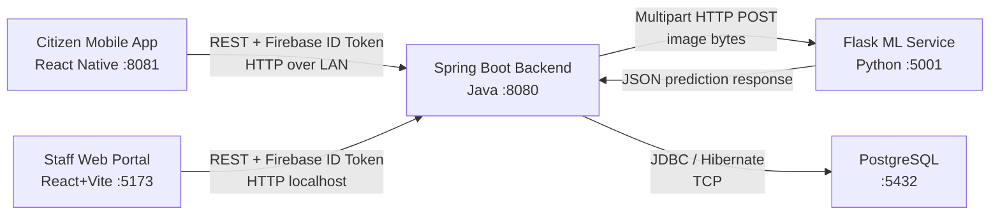
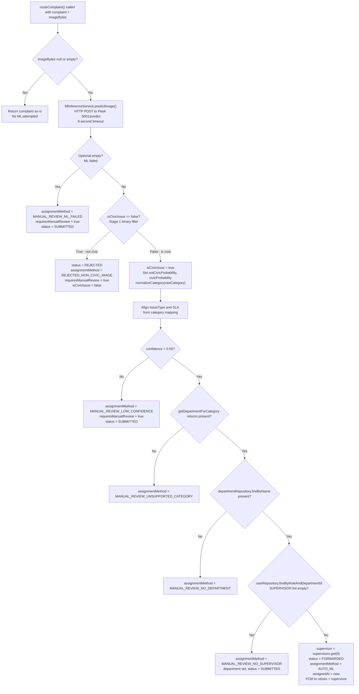
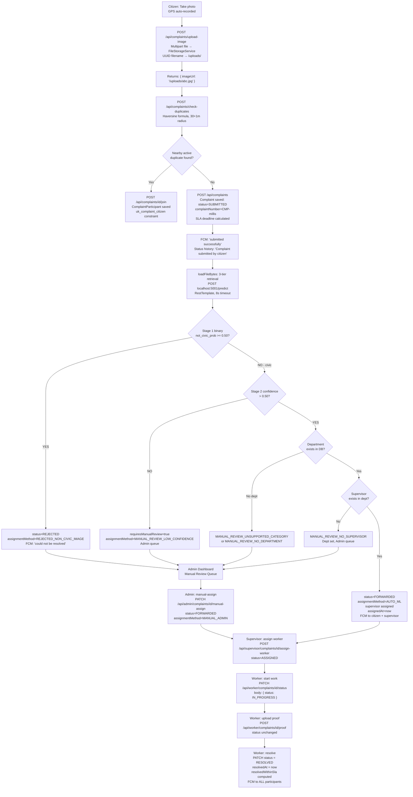
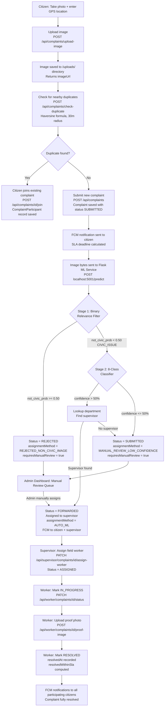

# UrbanPulse

An AI-powered civic issue reporting and management system.

---

## 1. Project Overview

UrbanPulse is a smart civic grievance platform that helps citizens report everyday city problems like potholes, garbage, broken streetlights, and damaged road signs. 

Instead of waiting in long queues or calling municipal offices, citizens take a photo on their phone. UrbanPulse automatically identifies the issue using Artificial Intelligence (AI) and routes it directly to the right municipal department. City staff and supervisors can then review the issue, assign field workers, and resolve it quickly with photo proof.

---

## 2. Features

- **Easy Complaint Registration**: Citizens take a photo and their phone automatically records the exact GPS location.
- **AI-Based Image Classification**: An AI model inspects the photo and predicts what kind of civic issue it is (e.g., Garbage, Pothole, Fallen Tree).
- **Automatic Department Routing**: If the AI is confident (above 50%), the complaint goes straight to that department's supervisor. If not, it goes to the Admin for manual check.
- **Duplicate Detection & Joining**: If someone already reported the same problem within 30 meters, citizens can simply "Join" the issue instead of creating a duplicate ticket.
- **Role-Based Staff Dashboards**:
  - **Admin**: Oversees all complaints, manages departments, and reviews low-confidence issues.
  - **Supervisor**: Reviews department complaints and assigns tasks to workers.
  - **Worker**: Views assigned repair tasks with Google Maps links and uploads proof photos when finished.
- **Live Complaint Tracking**: Citizens can track their complaint status from `SUBMITTED` to `FORWARDED`, `IN_PROGRESS`, and `RESOLVED`.

---

## 3. Technology Stack

- **React Native**: Builds the cross-platform mobile application for citizens.
- **React.js & Vite**: Builds the fast web dashboard for municipality staff, supervisors, and admins.
- **Java & Spring Boot**: The main backend server that handles business logic, security, and REST APIs.
- **PostgreSQL**: The database that stores users, complaints, departments, and history logs.
- **Python & Flask**: Runs the AI/ML microservice that receives images and returns predictions.
- **TensorFlow / Keras**: Powers the MobileNetV2 deep learning model trained on civic issue images.
- **Google Maps**: Provides location links and maps for staff to easily find problem spots.

---

## 4. Project Structure

```text
Urban Pulse/
├── ml-resources/
│   └── CivicComplaintML/
│       ├── models/                 # Pretrained Keras model and class names
│       └── urbanpulse_ai/          # Python Flask ML microservice (Port 5001)
│
├── Urban-Pulse/                    # Java Spring Boot Backend (Port 8080)
│   ├── src/main/java/com/urbanpulse/
│   │   ├── controller/             # REST API endpoints
│   │   ├── service/                # Business logic and ML routing
│   │   ├── repository/             # Database access queries
│   │   └── entity/                 # Database tables (Complaint, User, Department)
│   └── uploads/                    # Folder where uploaded photos are stored
│
├── Urban-Pulse-FrontEnd/           # Frontend projects
│   ├── src/                        # Citizen mobile app screens and services
│   ├── android/                    # Android native app files
│   └── staff-web/                  # Staff React + Vite web dashboard (Port 5173)
│
└── README.md                       # Project documentation
```

### How the Components Talk to Each Other
- The **Citizen Mobile App** sends complaints and images to the **Spring Boot Backend** (`:8080`).
- The **Spring Boot Backend** forwards the image to the **Flask ML Service** (`:5001`) to get the predicted category.
- The **Backend** stores all complaints and users inside the **PostgreSQL Database** (`:5432`).
- The **Staff Web Portal** (`:5173`) talks to the **Spring Boot Backend** to show complaints to admins, supervisors, and workers.

---

## 5. Setup and How to Run

### Software Requirements
Before running the project, install:
- **Java JDK 17**
- **Apache Maven 3.8+**
- **Python 3.10 to 3.13**
- **PostgreSQL 14+** (Version 18 is tested)
- **Node.js (v20 or v22)** and **npm**
- **Android Studio** (for running the mobile app on an emulator or Android phone)

---

### Step-by-Step Startup Guide (Open 5 CMD Windows)

Open separate Command Prompt (`cmd`) windows for each service. Keep all windows running while using the application.

---

#### CMD 1: PostgreSQL Database (Port 5432)
*Open Command Prompt as Administrator.*

1. Start the PostgreSQL Windows service:
   ```cmd
   net start postgresql-x64-18
   ```
2. Verify it is running:
   ```cmd
   sc query postgresql-x64-18
   ```
   *(Status should say `RUNNING`)*
3. Make sure the database named `urbanpulse` exists:
   ```cmd
   psql -U postgres -c "CREATE DATABASE urbanpulse;"
   ```

---

#### CMD 2: Flask ML Service (Port 5001)

1. Go to the project root folder:
   ```cmd
   cd "C:\Users\HP\Urban Pulse"
   ```
2. Run the Flask application:
   ```cmd
   python "ml-resources\CivicComplaintML\urbanpulse_ai\app.py"
   ```
3. **Verify it is running:**  
   Open your browser and visit: `http://localhost:5001/health`  
   You should see: `{"status": "ok", "model_loaded": true, "num_classes": 8}`

---

#### CMD 3: Spring Boot Backend (Port 8080)

1. Go to the backend folder:
   ```cmd
   cd "C:\Users\HP\Urban Pulse\Urban-Pulse"
   ```
2. Start the Spring Boot server:
   ```cmd
   mvn spring-boot:run
   ```
3. **Verify it is running:**  
   Open your browser and visit: `http://localhost:8080/api/test`  
   You should see: `UrbanPulse Backend is running`

---

#### CMD 4: Staff Web Portal (Port 5173)

1. Go to the staff web folder:
   ```cmd
   cd "C:\Users\HP\Urban Pulse\Urban-Pulse-FrontEnd\staff-web"
   ```
2. Install packages (first time only):
   ```cmd
   npm install
   ```
3. Start the Vite server:
   ```cmd
   npm run dev
   ```
4. **Open in browser:**  
   Visit: `http://localhost:5173` to view the Staff Portal login screen.

---

#### CMD 5: Citizen Mobile App (Port 8081)

1. Go to the mobile app folder:
   ```cmd
   cd "C:\Users\HP\Urban Pulse\Urban-Pulse-FrontEnd"
   ```
2. Install packages (first time only):
   ```cmd
   npm install
   ```
3. Set your laptop's local IP address:
   Open `src\config\api.ts` and set your computer's Wi-Fi IP (e.g. `http://192.168.1.50:8080`).  
   *(Do not use `localhost` if testing on a real Android phone).*
4. Start Metro bundler:
   ```cmd
   npm start
   ```
5. In another CMD window, launch the app on your connected Android phone or emulator:
   ```cmd
   cd "C:\Users\HP\Urban Pulse\Urban-Pulse-FrontEnd"
   npx react-native run-android
   ```

---

## 6. How the System Works

This section is a **complete, research-grade technical reference** for the UrbanPulse platform. Every detail below is derived directly from the production source code. This section is intended to give researchers, developers, and academic authors every minute implementation fact needed to write a comprehensive research paper.

---

### 6.1 High-Level Architecture

UrbanPulse is a **distributed, four-tier platform** composed of four independently deployable services that communicate exclusively over HTTP REST.

| Layer | Technology | Port | Role |
|---|---|---|---|
| Citizen Mobile App | React Native (TypeScript) | 8081 (Metro) | Citizens submit complaints, view status, join duplicates |
| Staff Web Portal | React + Vite (TypeScript) | 5173 | Admins, Supervisors, Workers manage complaints |
| Spring Boot Backend | Java 17 + Spring Boot 3.3.4 | 8080 | Business logic, security, DB access, ML orchestration |
| Flask ML Microservice | Python 3 + Flask + TensorFlow 2 | 5001 | Deep learning image classification |

The PostgreSQL 14+ database (port 5432) is accessed **exclusively** by the Spring Boot backend via Hibernate ORM. No frontend ever contacts the database directly.

**Network topology for development**: Both the React Native mobile app and the Flask ML microservice must resolve the Spring Boot backend at the developer's LAN IP address (configured in `Urban-Pulse-FrontEnd/src/config/api.ts` and `application.properties`), because Android emulators and physical devices cannot resolve `localhost` to the host machine.



---

### 6.2 Authentication System — Firebase Phone OTP + Stateless JWT

UrbanPulse deliberately avoids username/password authentication. It uses **Firebase Phone Authentication** combined with a **fully stateless backend**. No server-side sessions are maintained.

#### 6.2.1 Login Flow — Exact Step-by-Step

1. Citizen opens the React Native app and enters their Indian mobile number.
2. The app calls **Firebase Authentication SDK** (`firebase/auth`), which sends an OTP via SMS through Firebase's global telephony infrastructure.
3. The citizen enters the 6-digit OTP. Firebase validates it and returns a **Firebase ID Token** — a digitally signed JWT (RS256) with 1-hour expiry.
4. The app calls `POST /api/auth/login` with `{ "idToken": "<firebase_id_token>" }`.
5. The Spring Boot `AuthController` calls `UserService.loginOrRegister(idToken)`.
6. `UserService` calls `FirebaseAuthService.verifyIdToken(idToken)`, which internally calls the Firebase Admin SDK method `FirebaseAuth.getInstance().verifyIdToken(idToken)`. This performs cryptographic verification of the token's RS256 signature against Google's public key.
7. The verified `FirebaseToken` object contains a `claims` map. The backend extracts the `phone_number` claim (e.g., `"+919876543210"`).
8. `PhoneNumberUtil.normalize()` converts the phone number to canonical form `"+91 XXXXXXXXXX"`.
9. `UserRepository.findById(normalizedPhone)` checks the PostgreSQL `users` table (primary key is the normalized mobile number):
   - **Existing user**: Returns their existing record (name, role, department).
   - **New user**: Automatically creates a new `User` entity with `role = CITIZEN` and saves it to the database. First-time citizens do not need to register separately.
10. The backend returns `AuthResponse { mobileNumber, name, role, departmentId, departmentName }` as JSON. **No backend-issued JWT is returned** — the Firebase ID Token itself serves as the ongoing credential.

#### 6.2.2 Per-Request Authentication — `FirebaseAuthenticationFilter`

Every subsequent API request must include the Firebase ID Token in the HTTP header:

```
Authorization: Bearer <firebase_id_token>
```

**`FirebaseAuthenticationFilter`** (`com.urbanpulse.security.FirebaseAuthenticationFilter`) extends Spring's `OncePerRequestFilter` and intercepts every HTTP request exactly once per request cycle.

**Exact filter logic** (from source):
1. Read `Authorization` header. If absent or not prefixed with `"Bearer "` → pass through without authentication (public endpoints remain accessible, protected endpoints will be blocked by `SecurityConfig`).
2. Extract the token string: `authHeader.substring(7).trim()`.
3. Call `firebaseAuthService.verifyIdToken(idToken)` → returns `FirebaseToken decodedToken` or throws.
4. Extract `phone_number` from `decodedToken.getClaims()` map.
5. Call `PhoneNumberUtil.normalize(phoneNumber)`.
6. Query `userService.findByMobileNumber(normalizedPhone)` → `Optional<User>`.
7. If user is present in DB:
   - Create `List<GrantedAuthority>` containing a single `SimpleGrantedAuthority("ROLE_" + user.getRole().name())`.
   - Create `UsernamePasswordAuthenticationToken(user.getMobileNumber(), idToken, authorities)`.
   - Set `authentication.setDetails(new WebAuthenticationDetailsSource().buildDetails(request))`.
   - Set into `SecurityContextHolder.getContext().setAuthentication(authentication)`.
   - The **principal name** in `Authentication.getName()` is the **normalized mobile number** (e.g., `"+91 9876543210"`), not the Firebase UID.
8. If Firebase token is invalid or user does not exist in DB → `SecurityContextHolder.clearContext()`, request continues but will be denied by `SecurityConfig` for protected paths.
9. `filterChain.doFilter(request, response)` — always called regardless of authentication result.

#### 6.2.3 Role-Based URL Access Control (`SecurityConfig`)

| URL Pattern | Required Role |
|---|---|
| `POST /api/auth/**` | Public (no authentication required) |
| `/uploads/**` | Public (image viewing, no token needed) |
| `/api/admin/complaints/**` | `ROLE_ADMIN` only |
| `/api/supervisor/complaints/**` | `ROLE_SUPERVISOR` only |
| `/api/worker/complaints/**` | `ROLE_WORKER` only |
| `POST /api/users/staff` | `ROLE_ADMIN` only |
| `POST /api/users/workers` | `ROLE_SUPERVISOR` only |
| `GET /api/users/workers` | `ROLE_SUPERVISOR` or `ROLE_ADMIN` |
| All other `/api/**` | Any authenticated user (any role) |

CORS is configured `allowedOrigins("*")` with allowed methods `GET, POST, PUT, PATCH, DELETE, OPTIONS` and allowed headers `*`. This supports both the mobile app (from any device IP) and the web portal.

#### 6.2.4 Phone Number Normalization — `PhoneNumberUtil.normalize()`

All phone numbers are stored and compared in **canonical format**: `"+91 XXXXXXXXXX"` (with a space after the country code). This prevents duplicate user records from different formatting of the same number.

**Algorithm (exact, from source)**:

```
Input: rawPhone (String)
1. Throw if null or blank.
2. Throw if input contains any [a-zA-Z] characters.
3. Strip all spaces, hyphens, parentheses: replaceAll("[\\s\\-()]", "")
4. Prefix handling (mutually exclusive):
   a. Starts with "+91"  → remove first 3 characters
   b. Starts with "91" AND total length == 12 → remove first 2 characters
   c. Starts with "0"  AND total length == 11 → remove first 1 character
   d. Starts with "+"  (non-Indian) → throw IllegalArgumentException
5. Validate remaining 10 digits against regex: ^[6-9]\d{9}$
   (Indian mobile numbers must start with 6, 7, 8, or 9)
6. Return "+91 " + cleaned
```

**Accepted formats**: `+919876543210`, `919876543210`, `09876543210`, `9876543210`, `+91 98765 43210`, `98765-43210`

**Rejected**: Numbers starting with 0–5, non-Indian prefixes, alphabetic characters, length ≠ 10 digits after stripping.

---

### 6.3 Complete REST API Reference

All endpoints are served by the Spring Boot backend on port `8080`.

#### 6.3.1 Authentication Endpoints (`AuthController`)

| Method | URL | Auth Required | Request Body | Response Body | HTTP Status |
|---|---|---|---|---|---|
| `POST` | `/api/auth/login` | None | `{ "idToken": "string" }` | `{ mobileNumber, name, role, departmentId, departmentName }` | 200 |
| `POST` | `/api/auth/test` | None | Firebase ID Token in body | Debug info | 200 |

#### 6.3.2 Complaint Endpoints — Citizen (`ComplaintController`)

| Method | URL | Auth Required | Request Body / Params | Response Body | HTTP Status |
|---|---|---|---|---|---|
| `POST` | `/api/complaints` | Any authenticated | `ComplaintRequest { issueType, severity, latitude, longitude, imageUrl }` | `ComplaintResponse` | 200 |
| `GET` | `/api/complaints/my` | Any authenticated | — | `List<ComplaintResponse>` | 200 |
| `GET` | `/api/complaints/joined` | Any authenticated | — | `List<ComplaintResponse>` | 200 |
| `GET` | `/api/complaints/{id}` | Any authenticated | Path variable `id` | `ComplaintResponse` | 200 |
| `POST` | `/api/complaints/upload-image` | Any authenticated | `multipart/form-data` field `file` | `{ "imageUrl": "/uploads/<uuid>.jpg" }` | 200 |
| `POST` | `/api/complaints/check-duplicates` | Any authenticated | `DuplicateCheckRequest { issueType, latitude, longitude, radiusMeters }` | `List<ComplaintResponse>` | 200 |
| `POST` | `/api/complaints/{id}/join` | `ROLE_CITIZEN` | Path variable `id` | `{ joinCount, alreadyJoined, isOriginalReporter }` | 200 |
| `GET` | `/api/complaints/{id}/participation` | Any authenticated | Path variable `id` | `{ hasJoined, isOriginalReporter, joinCount }` | 200 |
| `GET` | `/api/complaints/{id}/join-count` | Any authenticated | Path variable `id` | `{ joinCount }` | 200 |

#### 6.3.3 Admin Endpoints (`AdminComplaintController`)

| Method | URL | Auth Required | Request Body | Response Body | HTTP Status |
|---|---|---|---|---|---|
| `GET` | `/api/admin/complaints` | `ROLE_ADMIN` | — | `List<ComplaintResponse>` | 200 |
| `PATCH` | `/api/admin/complaints/{id}/forward` | `ROLE_ADMIN` | `{ departmentId, supervisorMobile }` | `ComplaintResponse` | 200 |
| `PATCH` | `/api/admin/complaints/{id}/manual-assign` | `ROLE_ADMIN` | `AdminManualAssignRequest { departmentId, supervisorMobile }` | `ComplaintResponse` | 200 |

#### 6.3.4 Supervisor Endpoints

| Method | URL | Auth Required | Request Body | Response Body |
|---|---|---|---|---|
| `GET` | `/api/supervisor/complaints` | `ROLE_SUPERVISOR` | — | `List<ComplaintResponse>` |
| `POST` | `/api/supervisor/complaints/{id}/assign-worker` | `ROLE_SUPERVISOR` | `{ workerMobile }` | `ComplaintResponse` |

#### 6.3.5 Worker Endpoints (`WorkerComplaintController`)

| Method | URL | Auth Required | Request Body | Response Body |
|---|---|---|---|---|
| `GET` | `/api/worker/complaints` | `ROLE_WORKER` | — | `List<ComplaintResponse>` |
| `PATCH` | `/api/worker/complaints/{id}/status` | `ROLE_WORKER` | `{ status }` | `ComplaintResponse` |
| `POST` | `/api/worker/complaints/{id}/proof` | `ROLE_WORKER` | `multipart/form-data` field `file` | `ComplaintResponse` |

#### 6.3.6 User Management Endpoints

| Method | URL | Auth Required | Request Body | Response Body |
|---|---|---|---|---|
| `POST` | `/api/users/staff` | `ROLE_ADMIN` | `CreateUserRequest { name, mobileNumber, role, departmentId }` | `User` |
| `POST` | `/api/users/workers` | `ROLE_SUPERVISOR` | `CreateUserRequest` | `User` |
| `GET` | `/api/users/workers` | `ROLE_SUPERVISOR` or `ROLE_ADMIN` | — | `List<User>` |
| `POST` | `/api/users/fcm-token` | Any authenticated | `{ fcmToken }` | `200 OK` |

#### 6.3.7 Department Endpoints

| Method | URL | Auth Required | Description |
|---|---|---|---|
| `POST` | `/api/departments/**` | `ROLE_ADMIN` | Create or update departments |
| `GET` | `/api/departments/**` | `ROLE_ADMIN` or `ROLE_SUPERVISOR` | List departments |

#### 6.3.8 Static Resources

| URL Pattern | Auth Required | Purpose |
|---|---|---|
| `/uploads/**` | None (public) | Serve complaint and proof images stored on disk |

---

### 6.4 Database Schema — Complete Column Reference

The database is managed by **Hibernate ORM** with `spring.jpa.hibernate.ddl-auto=update`. The schema is derived from Java entity classes. All entity classes use Lombok `@Data`, `@NoArgsConstructor`, `@AllArgsConstructor`, `@Builder` annotations.

#### 6.4.1 `users` Table

**Entity class**: `com.urbanpulse.entity.User`

| Column Name | Java Field | Java Type | JPA Annotation | Nullable | Unique | Notes |
|---|---|---|---|---|---|---|
| `mobile_number` | `mobileNumber` | `String` | `@Id @Column(name="mobile_number")` | No | Yes (PK) | Canonical format: `+91 XXXXXXXXXX`. Primary key — no auto-generated integer. |
| `name` | `name` | `String` | `@Column(name="name", nullable=true)` | Yes | No | Display name, populated from app profile. |
| `role` | `role` | `Role` (enum) | `@Enumerated(EnumType.STRING)` | No | No | Values: `CITIZEN`, `ADMIN`, `SUPERVISOR`, `WORKER` |
| `department_id` | `department` | `Department` | `@ManyToOne @JoinColumn(name="department_id")` | Yes | No | FK to `departments.id`. Null for CITIZEN, ADMIN. |
| `fcm_token` | `fcmToken` | `String` | `@Column(name="fcm_token", length=512)` | Yes | No | Firebase Cloud Messaging device token. Updated on each app launch. |
| `created_at` | `createdAt` | `LocalDateTime` | `@CreationTimestamp` | No | No | Auto-set by Hibernate on INSERT. |
| `updated_at` | `updatedAt` | `LocalDateTime` | `@UpdateTimestamp` | Yes | No | Auto-set by Hibernate on UPDATE. |

#### 6.4.2 `departments` Table

**Entity class**: `com.urbanpulse.entity.Department`

| Column Name | Java Field | Java Type | Nullable | Unique | Notes |
|---|---|---|---|---|---|
| `id` | `id` | `Long` | No | Yes (PK) | Auto-generated `IDENTITY` sequence. |
| `name` | `name` | `String` | No | Yes | Unique department name. |
| `description` | `description` | `String` | Yes | No | Human-readable description of what civic issues the department handles. |

#### 6.4.3 `complaints` Table

**Entity class**: `com.urbanpulse.entity.Complaint`

| Column Name | Java Field | Java Type | Nullable | Unique | Notes |
|---|---|---|---|---|---|
| `id` | `id` | `Long` | No | Yes (PK) | Auto-generated `IDENTITY`. |
| `complaint_number` | `complaintNumber` | `String` | No | Yes | Format: `"CMP-" + System.currentTimeMillis()`. Unique. |
| `issue_type` | `issueType` | `IssueType` (enum) | No | No | Enum stored as STRING. Values: `POTHOLE, GARBAGE, WATER_LEAK, DRAINAGE_ISSUE, STREET_LIGHT_DAMAGE, INFRASTRUCTURE_DAMAGE, NONE`. |
| `status` | `status` | `ComplaintStatus` (enum) | No | No | Enum stored as STRING. Values: `SUBMITTED, FORWARDED, ASSIGNED, IN_PROGRESS, RESOLVED, CLOSED, REJECTED`. |
| `severity` | `severity` | `String` | Yes | No | `"LOW"`, `"MEDIUM"`, `"HIGH"`. Citizen-supplied; defaults to `MEDIUM`. |
| `priority` | `priority` | `String` | Yes | No | Reserved for future use. |
| `latitude` | `latitude` | `Double` | No | No | GPS latitude. Validated: must be in range −90 to +90. |
| `longitude` | `longitude` | `Double` | No | No | GPS longitude. Validated: must be in range −180 to +180. |
| `image_url` | `imageUrl` | `String` | No | No | `length=1024`. Path like `/uploads/<uuid>.jpg`. Returned from `POST /upload-image`. |
| `proof_image_url` | `proofImageUrl` | `String` | Yes | No | `length=1024`. Worker uploads proof before RESOLVED. |
| `confidence_score` | `confidenceScore` | `Double` | Yes | No | Stage 2 softmax confidence (0.0–1.0). |
| `created_at` | `createdAt` | `LocalDateTime` | No | No | `@CreationTimestamp`. Not updatable. |
| `updated_at` | `updatedAt` | `LocalDateTime` | Yes | No | `@UpdateTimestamp`. Auto-updated on save. |
| `sla_hours` | `slaHours` | `Integer` | Yes | No | SLA window in hours (6, 12, 24, or 48). |
| `sla_deadline` | `slaDeadline` | `LocalDateTime` | Yes | No | `createdAt + slaHours`. Never reset. |
| `resolved_at` | `resolvedAt` | `LocalDateTime` | Yes | No | Recorded when status = `RESOLVED`. |
| `resolved_within_sla` | `resolvedWithinSla` | `Boolean` | Yes | No | `resolvedAt <= slaDeadline`. Computed at resolution time. |
| `citizen_id` | `citizen` | `User` | No | No | FK to `users.mobile_number`. `@ManyToOne(EAGER)`. Original reporter. |
| `department_id` | `department` | `Department` | Yes | No | FK to `departments.id`. `@ManyToOne(EAGER)`. Set by routing. |
| `assigned_worker_id` | `assignedWorker` | `User` | Yes | No | FK to `users.mobile_number`. `@ManyToOne(EAGER)`. |
| `assigned_supervisor_id` | `assignedSupervisor` | `User` | Yes | No | FK to `users.mobile_number`. `@ManyToOne(EAGER)`. |
| `predicted_category` | `predictedCategory` | `String` | Yes | No | Canonical ML category name (e.g., `"Garbage"`). |
| `model_version` | `modelVersion` | `String` | Yes | No | ML model filename used for prediction. |
| `is_civic_issue` | `isCivicIssue` | `Boolean` | Yes | No | Stage 1 binary filter result: `true` = civic, `false` = non-civic. |
| `binary_prediction` | `binaryPrediction` | `String` | Yes | No | `"CIVIC_ISSUE"`, `"NOT_CIVIC_ISSUE"`, or admin override string. |
| `not_civic_probability` | `notCivicProbability` | `Double` | Yes | No | Stage 1 sigmoid output probability (probability that image is NOT a civic issue). |
| `civic_probability` | `civicProbability` | `Double` | Yes | No | `1.0 - notCivicProbability`. |
| `assignment_method` | `assignmentMethod` | `String` | Yes | No | See 6.5.3 for all 9 possible values. |
| `requires_manual_review` | `requiresManualReview` | `Boolean` | Yes | No | `true` → complaint appears in Admin review queue. |
| `admin_review_reason` | `adminReviewReason` | `String` | Yes | No | `length=512`. Human-readable reason. |
| `assigned_at` | `assignedAt` | `LocalDateTime` | Yes | No | Timestamp when supervisor was auto-assigned by routing. |

#### 6.4.4 `complaint_status_history` Table

**Entity class**: `com.urbanpulse.entity.ComplaintStatusHistory`

| Column Name | Java Field | Java Type | Nullable | Notes |
|---|---|---|---|---|
| `id` | `id` | `Long` | No (PK) | Auto-generated `IDENTITY`. |
| `complaint_id` | `complaint` | `Complaint` | No | FK to `complaints.id`. `@ManyToOne(EAGER)`. |
| `old_status` | `oldStatus` | `ComplaintStatus` | Yes | `null` for the initial SUBMITTED history entry. |
| `new_status` | `newStatus` | `ComplaintStatus` | No | The status after the transition. |
| `changed_by` | `changedBy` | `User` | Yes | `@ManyToOne(EAGER) @JoinColumn(nullable=true)`. Null for system-generated transitions. |
| `changed_at` | `changedAt` | `LocalDateTime` | No | `@CreationTimestamp`. Not updatable. |
| `remarks` | `remarks` | `String` | Yes | `length=1024`. Human-readable explanation. First entry always: `"Complaint submitted by citizen"`. |

#### 6.4.5 `complaint_participants` Table

**Entity class**: `com.urbanpulse.entity.ComplaintParticipant`

**DB-level unique constraint**: `uk_complaint_citizen` on `(complaint_id, citizen_id)` — prevents the same citizen from joining the same complaint twice at the database level.

| Column Name | Java Field | Java Type | Nullable | Notes |
|---|---|---|---|---|
| `id` | `id` | `Long` | No (PK) | Auto-generated `IDENTITY`. |
| `complaint_id` | `complaint` | `Complaint` | No | FK to `complaints.id`. `@ManyToOne(LAZY)`. |
| `citizen_id` | `citizen` | `User` | No | FK to `users.mobile_number`. `@ManyToOne(LAZY)`. `referencedColumnName="mobile_number"`. |
| `joined_at` | `joinedAt` | `LocalDateTime` | No | `@CreationTimestamp`. Not updatable. |

---

### 6.5 Two-Stage Cascaded ML Pipeline — Complete Technical Reference

This is the core AI innovation of UrbanPulse. After a complaint is saved, `AutomaticRoutingService.routeComplaint()` orchestrates the entire ML classification and routing pipeline.

#### 6.5.1 Stage 1 — Binary Civic Relevance Filter

**Model file**: `ml-resources/CivicComplaintML/models/urbanpulse_binary_v2_best.keras` (9.18 MB)

**Architecture**: MobileNetV2 (pretrained ImageNet weights, fine-tuned) → `GlobalAveragePooling2D` → `Dropout` → `Dense(1, activation='sigmoid')`

**Purpose**: Gate-keeping filter that rejects photographs that are clearly not civic infrastructure problems (selfies, food photos, indoor objects, random street scenes without issues).

**Inference logic (exact from Flask `app.py`)**:
```python
# Stage 1: Binary civic relevance
not_civic_prob = float(binary_model.predict(image_array, verbose=0)[0][0])
civic_prob = 1.0 - not_civic_prob
is_civic = not_civic_prob < 0.50
```

> **Critical interpretation**: The sigmoid output represents the probability of `NOT_CIVIC_ISSUE`. A low sigmoid output (< 0.50) means the image IS civic. This is a common convention in binary classification where the positive class is encoded as 1 = "not what we want to let through."

**Decision rule**:
- `not_civic_prob >= 0.50` → Image is classified `NOT_CIVIC_ISSUE`
  - Spring Boot sets: `complaint.setStatus(REJECTED)`, `isCivicIssue = false`, `binaryPrediction = "NOT_CIVIC_ISSUE"`, `requiresManualReview = true`, `assignmentMethod = "REJECTED_NON_CIVIC_IMAGE"`
  - `adminReviewReason` = `"Stage 1 Binary Relevance Filter: Non-civic image detected (NOT_CIVIC_ISSUE, non-civic confidence: XX.X%)"`
  - Routing terminates here. No Stage 2 is called.
- `not_civic_prob < 0.50` → Image is classified `CIVIC_ISSUE` → proceed to Stage 2.

#### 6.5.2 Stage 2 — Eight-Class Civic Issue Classifier

**Model file**: `ml-resources/CivicComplaintML/models/urbanpulse_8class_pothole_stage1.keras` (9.29 MB)

**Class names file**: `ml-resources/CivicComplaintML/models/urbanpulse_8class_class_names.json`

**Exact raw class names from JSON** (as the model outputs them):
```json
["Damaged concrete structures", "DamagedElectricalPoles", "DamagedRoadSigns",
 "DeadAnimalsPollution", "FallenTrees", "Garbage", "IllegalParking",
 "Potholes and RoadCracks"]
```

**Architecture**: MobileNetV2 (with built-in `TrueDivide` and `Subtract` preprocessing layers) → softmax output (8 neurons)

**Input preprocessing pipeline** (Flask `app.py`, exact steps):
1. Read image bytes from multipart form field named `file` (fallback: `image`).
2. `PIL.Image.open(io.BytesIO(image_bytes)).convert('RGB')` — force 3-channel RGB.
3. `image.resize((224, 224))` — resize to model input dimensions.
4. `np.array(image, dtype=np.float32)` — convert to float32 NumPy array, pixel values in range [0, 255].
5. **No manual normalization applied** — the MobileNetV2 model contains internal `TrueDivide` and `Subtract` preprocessing layers that perform normalization internally.
6. `np.expand_dims(image_array, axis=0)` → shape `[1, 224, 224, 3]`.
7. `predictions = multiclass_model.predict(image_array, verbose=0)[0]` → 1D array of 8 softmax probabilities.
8. `predicted_idx = int(np.argmax(predictions))` → index of winning class.
9. `confidence = float(predictions[predicted_idx])` → probability of predicted class.

**Flask `/predict` JSON response structure**:
```json
{
  "predictedClass": "Garbage",
  "confidence": 0.9079,
  "probabilities": [0.03, 0.91, 0.01, 0.0, 0.01, 0.0, 0.0, 0.03],
  "classProbabilities": {
    "Damaged concrete structures": 0.03,
    "DamagedElectricalPoles": 0.01,
    "DamagedRoadSigns": 0.0,
    "DeadAnimalsPollution": 0.0,
    "FallenTrees": 0.01,
    "Garbage": 0.91,
    "IllegalParking": 0.0,
    "Potholes and RoadCracks": 0.03
  },
  "modelVersion": "urbanpulse_8class_pothole_stage1",
  "isCivicIssue": true,
  "binaryPrediction": "CIVIC_ISSUE",
  "notCivicProbability": 0.07,
  "civicProbability": 0.93
}
```

**Flask `/health` response structure**:
```json
{
  "status": "ok",
  "model_loaded": true,
  "model_name": "urbanpulse_8class_pothole_stage1",
  "model_version": "urbanpulse_8class_pothole_stage1",
  "num_classes": 8,
  "input_dimensions": [224, 224, 3],
  "input_shape": [null, 224, 224, 3],
  "classes": ["Damaged concrete structures", "DamagedElectricalPoles", ...]
}
```

#### 6.5.3 ML Call — Spring Boot → Flask (`MlInferenceService`)

`MlInferenceService.predictImage(byte[] imageBytes, String filename)`:
- Uses Spring `RestTemplate` with `MultiValueMap` body.
- Content-Type: `multipart/form-data`.
- Form field name: `file`.
- Timeout: **8 seconds** (`urbanpulse.ml.timeout-ms=8000` in `application.properties`).
- Returns `Optional<MlPredictionResponse>` — empty `Optional` on any failure.
- **Critical guarantee**: ML failures are fully isolated and never abort complaint creation.

#### 6.5.4 Confidence-Based Routing Decision (`AutomaticRoutingService`)

Configurable threshold: `urbanpulse.ml.confidence-threshold=0.50` (application.properties).

**Exact decision rule** (source: `AutomaticRoutingService.routeComplaint()`):
```java
if (confidence != null && confidence > confidenceThreshold) {
    // Auto-route to department supervisor
} else {
    // Route to Admin for manual review
}
```

Note: The comparison is **strictly greater than** (`>`), not `>=`. A confidence of exactly 0.50 triggers manual review.

#### 6.5.5 All `assignmentMethod` Values

| Value | Meaning |
|---|---|
| `AUTO_ML` | AI classified with >50% confidence and supervisor was found. Fully automatic. |
| `MANUAL_ADMIN` | Admin manually forwarded a complaint via the dashboard. |
| `MANUAL_REVIEW_ML_FAILED` | Flask ML service was unreachable or timed out. |
| `MANUAL_REVIEW_LOW_CONFIDENCE` | ML classified but confidence ≤ 50%. Not reliable enough to auto-route. |
| `MANUAL_REVIEW_UNSUPPORTED_CATEGORY` | ML returned a category not in `CategoryDepartmentMappingService`'s map. |
| `MANUAL_REVIEW_NO_DEPARTMENT` | Category maps to a department name but that department doesn't exist in the DB. |
| `MANUAL_REVIEW_NO_SUPERVISOR` | Department exists in DB but has no active `SUPERVISOR` user. |
| `MANUAL_REVIEW_ROUTING_EXCEPTION` | Unexpected Java exception during routing (catch-all). |
| `REJECTED_NON_CIVIC_IMAGE` | Stage 1 binary filter determined image is not a civic issue. |

---

### 6.6 Category-to-Department Mapping — Complete Reference

**Service class**: `com.urbanpulse.service.CategoryDepartmentMappingService`

The mapping is defined as an **immutable `LinkedHashMap`** initialized once in a `static` block at class load time.

#### 6.6.1 Raw ML Output → Canonical Name Normalization

| Raw ML Class Name (from model JSON) | Canonical Display Name |
|---|---|
| `Damaged concrete structures` | `Damaged Concrete Structures` |
| `Damaged Concrete Structures` | `Damaged Concrete Structures` |
| `DamagedElectricalPoles` | `Damaged Electrical Poles` |
| `Damaged Electrical Poles` | `Damaged Electrical Poles` |
| `DamagedRoadSigns` | `Damaged Road Signs` |
| `Damaged Road Signs` | `Damaged Road Signs` |
| `DeadAnimalsPollution` | `Dead Animals Pollution` |
| `Dead Animals Pollution` | `Dead Animals Pollution` |
| `FallenTrees` | `Fallen Trees` |
| `Fallen Trees` | `Fallen Trees` |
| `Garbage` | `Garbage` |
| `IllegalParking` | `Illegal Parking` |
| `Illegal Parking` | `Illegal Parking` |
| `Potholes and RoadCracks` | `Potholes and Road Cracks` |
| `Potholes and Road Cracks` | `Potholes and Road Cracks` |

If none of the above match (even case-insensitively), `normalizeCategory()` returns the trimmed input string unchanged.

#### 6.6.2 Canonical Category → Department → IssueType → SLA

| Canonical Category | Responsible Department | IssueType Enum | SLA Hours |
|---|---|---|---|
| `Damaged Concrete Structures` | Engineering Department | `INFRASTRUCTURE_DAMAGE` | 48 |
| `Damaged Electrical Poles` | Electrical Department | `STREET_LIGHT_DAMAGE` | 24 |
| `Damaged Road Signs` | Road Safety Department | `INFRASTRUCTURE_DAMAGE` | 48 |
| `Dead Animals Pollution` | Public Health Department | `DRAINAGE_ISSUE` | 12 |
| `Fallen Trees` | Horticulture Department | `INFRASTRUCTURE_DAMAGE` | 48 |
| `Garbage` | Sanitation Department | `GARBAGE` | 12 |
| `Illegal Parking` | Traffic Department | `INFRASTRUCTURE_DAMAGE` | 48 |
| `Potholes and Road Cracks` | Road Safety Department | `POTHOLE` | 24 |

> **Implementation discrepancy worth noting in research**: `DepartmentInitializer` creates the department `"Roads and Infrastructure Department"` (description: "Potholes and Road Cracks"), but `CategoryDepartmentMappingService` maps the category `"Potholes and Road Cracks"` to the department name `"Road Safety Department"`. Both `"Roads and Infrastructure Department"` and `"Road Safety Department"` are created in the DB, but only `"Road Safety Department"` is used by the routing engine for Potholes. This means the `"Roads and Infrastructure Department"` department is seeded in the DB but receives no complaints from the ML routing pipeline.

---

### 6.7 Department Initialization — `DepartmentInitializer`

**Class**: `com.urbanpulse.config.DepartmentInitializer`
**Annotation**: `@Component @Order(2) implements CommandLineRunner`
**Runs at**: Spring Boot startup, after `AdminAccountInitializer` (`@Order(1)` implied).

The initializer calls `initializeDepartments()` which checks `departmentRepository.existsByName(deptName)` before inserting. This makes it **fully idempotent** — safe to run on every restart without creating duplicates.

**Exact 8 departments seeded** (name → description):

| Department Name | Description |
|---|---|
| `Engineering Department` | `Damaged Concrete Structures` |
| `Electrical Department` | `Damaged Electrical Poles` |
| `Road Safety Department` | `Damaged Road Signs` |
| `Public Health Department` | `Dead Animals Pollution` |
| `Horticulture Department` | `Fallen Trees` |
| `Sanitation Department` | `Garbage` |
| `Traffic Department` | `Illegal Parking` |
| `Roads and Infrastructure Department` | `Potholes and Road Cracks` |

---

### 6.8 Automatic Routing — Full Decision Tree



---

### 6.9 Service Level Agreement (SLA) Tracking — `SlaService`

**Class**: `com.urbanpulse.service.SlaService`

#### 6.9.1 SLA Hours Configuration (from `static` block in `SlaService`)

| IssueType Enum | SLA Window |
|---|---|
| `GARBAGE` | 12 hours |
| `WATER_LEAK` | 6 hours |
| `DRAINAGE_ISSUE` | 12 hours |
| `POTHOLE` | 24 hours |
| `STREET_LIGHT_DAMAGE` | 24 hours |
| `INFRASTRUCTURE_DAMAGE` | 48 hours |
| `NONE` (default) | 24 hours |
| Any null or unrecognized | 24 hours (default) |

#### 6.9.2 SLA Deadline Calculation

```java
// SlaService.calculateDeadline()
LocalDateTime deadline = createdAt.plusHours(slaHours);
```

The deadline is calculated **once at complaint creation** and **never reset** when the complaint is reassigned, forwarded, or when status changes. This prevents gaming the SLA by reassigning complaints near the deadline.

#### 6.9.3 SLA Status Determination

```java
// SlaService.getSlaStatus()
if (complaint.getStatus() == RESOLVED) return "RESOLVED";
if (now.isAfter(deadline)) return "OVERDUE";
long totalMinutes = slaHours * 60;
long remainingMinutes = ChronoUnit.MINUTES.between(now, deadline);
long dueSoonThreshold = (long)(totalMinutes * 0.20);  // 20% of total
if (remainingMinutes <= dueSoonThreshold) return "DUE_SOON";
return "ON_TIME";
```

**DUE_SOON threshold**: Exactly 20% of the total SLA duration remaining. Examples:
- 12-hour SLA: DUE_SOON when ≤ 144 minutes (2h 24m) remain.
- 24-hour SLA: DUE_SOON when ≤ 288 minutes (4h 48m) remain.
- 48-hour SLA: DUE_SOON when ≤ 576 minutes (9h 36m) remain.

#### 6.9.4 Resolution SLA Check

```java
// SlaService.isResolvedWithinSla()
return !complaint.getResolvedAt().isAfter(complaint.getSlaDeadline());
```

`resolvedWithinSla = true` iff `resolvedAt <= slaDeadline` (resolved on time or early).

#### 6.9.5 Legacy Backfill

`ComplaintService.backfillLegacyComplaints()` runs at startup via `@EventListener(ApplicationReadyEvent.class)`. It queries complaints where `slaHours IS NULL` and calculates/saves SLA fields for all historical complaints created before SLA tracking was introduced.

---

### 6.10 Duplicate Detection and Complaint Joining

#### 6.10.1 Duplicate Detection Algorithm — Haversine Formula

**Endpoint**: `POST /api/complaints/check-duplicates`

**Request body**:
```json
{
  "issueType": "POTHOLE",
  "latitude": 17.3850,
  "longitude": 78.4867,
  "radiusMeters": 30
}
```

**Algorithm** (implemented in `ComplaintService.checkDuplicates()`):

```
For each existing complaint C with same issueType:
  Δlat = toRadians(C.latitude - request.latitude)
  Δlon = toRadians(C.longitude - request.longitude)
  a = sin²(Δlat/2) + cos(request.latitude_rad) × cos(C.latitude_rad) × sin²(Δlon/2)
  c = 2 × atan2(√a, √(1−a))
  distance = 6,371,000 × c   (metres; Earth mean radius = 6,371 km)

GPS jitter tolerance: effectiveRadius = radiusMeters + 1.0 (1 metre added)
If distance <= effectiveRadius: include in results
```

**Result sorting priority**:
1. Active complaints (`SUBMITTED`, `FORWARDED`, `ASSIGNED`, `IN_PROGRESS`) sorted before resolved/rejected ones.
2. Among same activeness: shortest distance first.
3. Among same distance: newest complaint first (tiebreaker by `createdAt` descending).

**Rationale for 30m radius**: Urban GPS on consumer mobile devices has typical accuracy of ±3–5 metres. At 30m, two complaints about the same pothole reported from either side of the road will be correctly identified as duplicates. The 1m jitter tolerance adds a small buffer for boundary cases.

**Rationale for Haversine over Euclidean**: At distances of 30m–100m, planar Euclidean approximation on longitude/latitude is inaccurate because degrees of longitude vary in physical width with latitude (cosine effect). Haversine computes true great-circle distance.

#### 6.10.2 Joining an Existing Complaint

**Endpoint**: `POST /api/complaints/{id}/join`

**Business rules enforced** (from `ComplaintService.joinComplaint()`):
1. Caller must have `ROLE_CITIZEN`. Staff roles (ADMIN, SUPERVISOR, WORKER) cannot join complaints.
2. Complaint must be in an **active** status: `SUBMITTED`, `FORWARDED`, `ASSIGNED`, or `IN_PROGRESS`. Cannot join `RESOLVED`, `REJECTED`, or `CLOSED` complaints.
3. If the caller is the **original reporter** (`complaint.getCitizen().getMobileNumber().equals(callerMobile)`): return `{ alreadyJoined: true, isOriginalReporter: true, joinCount: <count> }` without inserting a new record.
4. Check if `ComplaintParticipant` record already exists for `(complaintId, callerMobile)`. If yes: return `{ alreadyJoined: true }`.
5. Otherwise: save `ComplaintParticipant { complaint, citizen, joinedAt }`. The database-level unique constraint `uk_complaint_citizen` provides a final safety net against race conditions.
6. The `joinCount` returned = count of `ComplaintParticipant` records for this complaint + 1 (for the original reporter).

**Notification on status change**: When any complaint status changes, `ComplaintService` collects FCM tokens from all `ComplaintParticipant` records + the original `citizen` record and sends individual FCM notifications to each. A `Set<String>` of already-notified tokens prevents sending duplicate notifications if the original reporter has also joined as a participant.

---

### 6.11 Complaint Status Lifecycle

#### 6.11.1 All Status Values

| Status | Meaning |
|---|---|
| `SUBMITTED` | Complaint created. Awaiting ML routing OR in Admin manual review queue. |
| `FORWARDED` | Complaint forwarded to a department supervisor (auto or manual). |
| `ASSIGNED` | Supervisor has assigned a field worker. |
| `IN_PROGRESS` | Worker has marked work as started. |
| `RESOLVED` | Worker has uploaded proof and marked complete. `resolvedAt` is set. |
| `CLOSED` | Admin or supervisor has formally closed the complaint. |
| `REJECTED` | Either Stage 1 AI filter rejected (non-civic image) OR worker could not resolve. |

#### 6.11.2 Allowed Status Transitions

Enforced by `validateStatusTransition()` in `ComplaintService`:

| From | To (allowed) | Who |
|---|---|---|
| `SUBMITTED` | `FORWARDED` | Admin (manual) or AutomaticRoutingService (auto) |
| `SUBMITTED` | `REJECTED` | AutomaticRoutingService (Stage 1 binary filter) |
| `FORWARDED` | `ASSIGNED` | Supervisor (assign-worker endpoint) |
| `ASSIGNED` | `IN_PROGRESS` | Worker |
| `ASSIGNED` | `REJECTED` | Worker |
| `IN_PROGRESS` | `RESOLVED` | Worker (requires proof image uploaded first) |
| `IN_PROGRESS` | `REJECTED` | Worker |

**Proof photo requirement for RESOLVED**: Before a worker can set status to `RESOLVED`, `complaint.getProofImageUrl()` must be non-null and non-empty. If it is null/empty, `ComplaintService` throws `IllegalArgumentException("Proof image must be uploaded before resolving a complaint")`, which is caught by `GlobalExceptionHandler` and returned as HTTP 400.

#### 6.11.3 Status History Records

Every status transition appends a new `ComplaintStatusHistory` row. First entry (at SUBMITTED):
- `oldStatus = null`, `newStatus = SUBMITTED`, `changedBy = citizen entity`, `remarks = "Complaint submitted by citizen"`

Subsequent routing history remarks examples:
- Auto-forwarded: `"Complaint automatically forwarded to Sanitation Department supervisor John Doe (ML confidence: 90.8%)"`
- ML failed: `"ML inference unavailable. Routed to Admin for manual review."`
- Stage 1 rejected: `"Stage 1 AI filter rejected: Image does not appear to contain a civic issue (87.3%). Flagged for Admin review."`

---

### 6.12 Push Notifications — Firebase Cloud Messaging

**Class**: `com.urbanpulse.service.NotificationService`

**Method**: `sendComplaintStatusNotification(String fcmToken, String complaintNumber, ComplaintStatus newStatus, String departmentName)`

**Annotation**: `@Async` — runs in a separate thread pool, never blocks the HTTP response thread.

**FCM notification title** (always): `"UrbanPulse: Complaint Update"`

**FCM notification body** — exact strings per status (from `buildNotificationBody()`):

| `newStatus` | Notification Body |
|---|---|
| `SUBMITTED` | `"Your complaint CMP-123456 has been submitted successfully."` |
| `FORWARDED` | `"Your complaint CMP-123456 has been forwarded to the Sanitation Department."` |
| `ASSIGNED` | `"Your complaint CMP-123456 has been assigned to a field worker."` |
| `IN_PROGRESS` | `"Work has started on your complaint CMP-123456."` |
| `RESOLVED` | `"Your complaint CMP-123456 has been resolved. Open app to view resolution proof."` |
| `REJECTED` | `"Your complaint CMP-123456 could not be resolved."` |
| `CLOSED` | `"Your complaint CMP-123456 has been closed."` |
| `null` | `"Your complaint CMP-123456 has an update."` |

**Additional FCM data payload** (key-value pairs alongside the notification):
- `complaintNumber` → complaint number string
- `status` → status enum name string

**Failure isolation**: The entire `sendComplaintStatusNotification()` method is wrapped in a `try/catch(Exception)`. Any FCM network failure, invalid token error, or Firebase SDK exception is caught, logged as a `WARN`, and swallowed — the complaint operation always completes regardless of FCM status.

**Token update**: Each device updates its FCM token via `POST /api/users/fcm-token`. The token is stored in `users.fcm_token` (VARCHAR 512). Firebase generates new tokens on app reinstall or token rotation.

---

### 6.13 File Storage — `FileStorageService`

**Upload directory**: `Paths.get("uploads").toAbsolutePath().normalize()` — resolved relative to the JVM working directory (the `Urban-Pulse/` folder). `Files.createDirectories(uploadDir)` is called in the constructor to auto-create on startup.

**File storage** (`storeFile(MultipartFile file)`):
1. Extract file extension from `getOriginalFilename()`. Default to `.jpg` if no extension found.
2. Generate unique filename: `UUID.randomUUID().toString() + extension` (e.g., `a1b2c3d4-e5f6-7890-abcd-ef1234567890.jpg`).
3. `Files.copy(file.getInputStream(), targetLocation, StandardCopyOption.REPLACE_EXISTING)` — `REPLACE_EXISTING` prevents errors if a UUID collision occurred (astronomically unlikely).
4. Return path string: `"/uploads/" + newFilename`.

**File retrieval for ML** (`loadFileBytes(String fileUri)`):

Three-tier fallback chain:
1. **Tier 1 — Relative to upload directory**: Extract filename from `/uploads/...` path, resolve against `uploadDir`, read with `Files.readAllBytes()`.
2. **Tier 2 — Absolute filesystem path**: Try `Paths.get(fileUri)` as a direct absolute path. Used for edge cases where full path was stored.
3. **Tier 3 — HTTP/HTTPS URL**: If `fileUri.startsWith("http://")` or `"https://"`, fetch bytes over network using `java.net.URI.create(fileUri).toURL().openStream().readAllBytes()`. Useful when image URL points to a remote host.

Returns `null` (not an exception) if all three tiers fail — the caller (`MlInferenceService`) handles null bytes gracefully by returning `Optional.empty()`.

---

### 6.14 `ComplaintResponse` DTO — All Fields

The `ComplaintResponse` DTO is returned by every complaint-related API endpoint. All fields:

| Field | Java Type | Description |
|---|---|---|
| `id` | `Long` | Database auto-generated complaint ID. |
| `complaintNumber` | `String` | Human-readable identifier (`CMP-<millis>`). |
| `issueType` | `IssueType` | Enum: POTHOLE, GARBAGE, etc. ML-updated after routing. |
| `status` | `ComplaintStatus` | Current lifecycle status. |
| `severity` | `String` | Citizen-supplied: LOW, MEDIUM, HIGH. |
| `priority` | `String` | Reserved field. |
| `latitude` | `Double` | GPS latitude. |
| `longitude` | `Double` | GPS longitude. |
| `imageUrl` | `String` | URL path to complaint photo (`/uploads/...`). |
| `proofImageUrl` | `String` | URL path to worker's proof photo. Null until RESOLVED. |
| `confidenceScore` | `Double` | Stage 2 ML confidence (0.0–1.0). |
| `createdAt` | `LocalDateTime` | Complaint creation timestamp. |
| `updatedAt` | `LocalDateTime` | Last modification timestamp. |
| `slaHours` | `Integer` | SLA window in hours. |
| `slaDeadline` | `LocalDateTime` | Absolute deadline timestamp. |
| `slaStatus` | `String` | ON_TIME, DUE_SOON, OVERDUE, or RESOLVED. |
| `remainingMinutes` | `Long` | Minutes until SLA deadline (can be negative if overdue). |
| `resolvedAt` | `LocalDateTime` | When complaint was resolved. Null if unresolved. |
| `resolvedWithinSla` | `Boolean` | True if resolved before deadline. |
| `citizenMobile` | `String` | Original reporter's normalized mobile number. |
| `citizenName` | `String` | Original reporter's display name. |
| `departmentId` | `Long` | Assigned department's DB id. |
| `departmentName` | `String` | Assigned department's display name. |
| `supervisorMobile` | `String` | Assigned supervisor's mobile number. |
| `supervisorName` | `String` | Assigned supervisor's display name. |
| `assignedWorkerMobile` | `String` | Assigned worker's mobile number. |
| `assignedWorkerName` | `String` | Assigned worker's display name. |
| `statusHistory` | `List<StatusHistoryResponse>` | Complete ordered audit log of all status changes. |
| `joinCount` | `Long` | Total number of citizens who have joined this complaint. |
| `hasJoined` | `Boolean` | Whether the calling citizen has already joined. |
| `isOriginalReporter` | `Boolean` | Whether the calling citizen is the original reporter. |
| `distanceMeters` | `Double` | Distance from search location (only populated in duplicate-check results). |
| `predictedCategory` | `String` | Canonical ML category name (e.g., `"Garbage"`). |
| `modelVersion` | `String` | ML model filename used. |
| `assignmentMethod` | `String` | One of 9 routing outcome codes (see 6.5.5). |
| `isCivicIssue` | `Boolean` | Stage 1 binary filter result. |
| `binaryPrediction` | `String` | `"CIVIC_ISSUE"` or `"NOT_CIVIC_ISSUE"`. |
| `notCivicProbability` | `Double` | Stage 1 sigmoid output (probability of non-civic). |
| `civicProbability` | `Double` | `1 - notCivicProbability`. |
| `requiresManualReview` | `Boolean` | Whether Admin intervention is needed. |
| `adminReviewReason` | `String` | Human-readable reason for manual review flag. |
| `assignedAt` | `LocalDateTime` | When supervisor was assigned. |

---

### 6.15 Exception Handling — `GlobalExceptionHandler`

**Class**: `com.urbanpulse.exception.GlobalExceptionHandler`
**Annotation**: `@RestControllerAdvice` — applies to all `@RestController` classes.

| Exception Type | HTTP Status | Response Body |
|---|---|---|
| `FirebaseAuthException` | 401 Unauthorized | `{ "error": "Authentication failed: <message>" }` |
| `IllegalArgumentException` | 400 Bad Request | `{ "error": "<exception message>" }` |
| `MethodArgumentNotValidException` | 400 Bad Request | `{ "error": "<field>: <message>, <field>: <message>, ..." }` (all validation errors concatenated) |
| `AccessDeniedException` | 403 Forbidden | `{ "error": "Access denied: <message>" }` |
| `IllegalStateException` | 400 Bad Request | `{ "error": "<exception message>" }` |
| `HttpMessageNotReadableException` | 400 Bad Request | `{ "error": "Invalid request body: <message>" }` |
| `MaxUploadSizeExceededException` | 413 Payload Too Large | `{ "error": "File too large. Maximum upload size is 25MB." }` |
| `MultipartException` | 400 Bad Request | `{ "error": "Invalid multipart request: <message>" }` |
| `Exception` (catch-all) | 500 Internal Server Error | `{ "error": "An unexpected error occurred: <message>" }` |

**File size limit**: Configured in `application.properties`:
```properties
spring.servlet.multipart.max-file-size=25MB
spring.servlet.multipart.max-request-size=25MB
```

---

### 6.16 Startup Initialization Sequence

The Spring Boot application performs the following initialization steps on startup, in order:

1. **Spring context loads** — All `@Component`, `@Service`, `@Repository`, `@Controller` beans are instantiated and dependency-injected.
2. **Firebase Admin SDK initialization** — `@Configuration` class reads `firebase-service-account.json` from the classpath and initializes `FirebaseApp`.
3. **Hibernate schema update** — With `ddl-auto=update`, Hibernate compares entity classes to PostgreSQL schema and applies `ALTER TABLE` statements for any new columns or tables. Existing data is preserved.
4. **`AdminAccountInitializer.run()` (`@Order(1)` implied)** — Reads `admin.mobile-number` from application.properties, normalizes it, and upserts the user record with `role = ADMIN`. Ensures at least one admin always exists.
5. **`DepartmentInitializer.run()` (`@Order(2)`)** — Idempotently seeds the 8 standard departments into the `departments` table.
6. **`ApplicationReadyEvent` fired** — `ComplaintService.backfillLegacyComplaints()` runs and calculates SLA fields for all historical complaints lacking them.
7. **Spring Boot embedded Tomcat** begins accepting HTTP requests on port 8080.

---

### 6.17 Frontend API Layer — React Native TypeScript

**File**: `Urban-Pulse-FrontEnd/src/services/complaintService.ts`

#### 6.17.1 API Timeouts (per operation)

| Operation | Timeout |
|---|---|
| `uploadImage` | 30,000 ms (30 s) — large file transfer |
| `createComplaint` | 20,000 ms (20 s) — ML pipeline included |
| Most `GET` operations | 15,000 ms (15 s) |
| `updateFcmToken` | 10,000 ms (10 s) |

Each request uses an `AbortController` with `setTimeout(() => controller.abort(), timeoutMs)` for timeout enforcement.

#### 6.17.2 `ComplaintData` TypeScript Interface

The frontend `ComplaintData` interface (used in `complaintService.ts`) mirrors all fields in `ComplaintResponse`:

```typescript
interface ComplaintData {
  id: number;
  complaintNumber: string;
  issueType: string;
  status: string;
  severity?: string;
  priority?: string;
  latitude: number;
  longitude: number;
  imageUrl: string;
  proofImageUrl?: string;
  confidenceScore?: number;
  createdAt: string;
  updatedAt?: string;
  slaHours?: number;
  slaDeadline?: string;
  slaStatus?: string;
  remainingMinutes?: number;
  resolvedAt?: string;
  resolvedWithinSla?: boolean;
  citizenMobile?: string;
  citizenName?: string;
  departmentId?: number;
  departmentName?: string;
  supervisorMobile?: string;
  supervisorName?: string;
  assignedWorkerMobile?: string;
  assignedWorkerName?: string;
  statusHistory?: StatusHistoryItem[];
  joinCount?: number;
  hasJoined?: boolean;
  isOriginalReporter?: boolean;
  distanceMeters?: number;
  predictedCategory?: string;
  modelVersion?: string;
  assignmentMethod?: string;
  isCivicIssue?: boolean;
  binaryPrediction?: string;
  notCivicProbability?: number;
  civicProbability?: number;
  requiresManualReview?: boolean;
  adminReviewReason?: string;
  assignedAt?: string;
}
```

#### 6.17.3 Image Upload Flow

```typescript
// complaintService.ts - uploadImage()
const formData = new FormData();
formData.append('file', {
  uri: imageUri,
  type: mimeType,       // e.g. 'image/jpeg'
  name: fileName,
});
// POST to: BASE_URL + '/api/complaints/upload-image'
// Header: Authorization: Bearer <firebaseIdToken>
// Returns: { imageUrl: '/uploads/<uuid>.jpg' }
```

**Base URL configuration**: Stored in `Urban-Pulse-FrontEnd/src/config/api.ts`. Must be set to the developer's LAN IP address (e.g., `http://192.168.1.50:8080`) for physical device testing. `localhost` only works in Android Studio emulators.

---

### 6.18 Role-Based Data Isolation

Role enforcement is applied at **three distinct layers**:

**Layer 1 — URL-level** (`SecurityConfig`): Entire API path prefixes are restricted by role (e.g., only `ROLE_ADMIN` can access any `POST /api/admin/**` endpoint).

**Layer 2 — Service-level**: Each service method re-checks the authenticated user's role before executing logic:
- `ComplaintService.joinComplaint()` explicitly checks the caller has `ROLE_CITIZEN`.
- `WorkerComplaintController` queries complaints by `assignedWorker.mobileNumber = callerMobile` to prevent workers seeing other workers' assignments.

**Layer 3 — Data-level** (query-level filtering):
- Supervisors can only retrieve workers in their own department (`findByRoleAndDepartmentId(WORKER, supervisor.getDepartment().getId())`).
- Workers can only update complaints specifically assigned to them (service checks `complaint.getAssignedWorker().getMobileNumber().equals(callerMobile)`).
- Citizens can only view their own complaints via `GET /api/complaints/my` (filtered by `citizen.mobileNumber = callerMobile`).

---

### 6.19 Complete End-to-End Complaint Flow



---

### 6.20 Key Design Decisions for Research

1. **Firebase Phone Authentication** was chosen over username/password to eliminate password management, reduce friction for low-literacy users, and leverage Firebase's global OTP infrastructure. The backend never stores passwords. The design is resistant to credential-stuffing attacks.

2. **Stateless architecture** (Firebase ID Tokens, no server-side sessions): Enables horizontal scaling of the Spring Boot backend. Any number of backend instances can serve any request without shared session state. Firebase handles token expiry and refresh.

3. **Two-stage cascaded ML pipeline** vs. single-stage multi-class classification: A single 9-class model (8 civic + 1 non-civic) would suffer from class imbalance between civic issue images (many rare categories) and non-civic images (nearly unlimited diversity). The two-stage design dedicates a specialized binary model to the rejection task and a specialized 8-class model to civic classification, achieving better discrimination in both tasks.

4. **MobileNetV2 architecture**: Chosen for its depthwise separable convolutions, which provide high accuracy with dramatically fewer parameters than ResNet or VGG, making it suitable for deployment on resource-constrained servers and enabling fast inference response within the 8-second timeout window.

5. **50% confidence threshold** (`>` strictly): Predictions at or below 50% are no better than random among the 8 output classes. The strict `>` rule ensures that exact ties (which MobileNetV2 rarely produces) also go to manual review. The threshold is externally configurable (`application.properties`) for tuning.

6. **Haversine formula with 1m GPS jitter tolerance**: Euclidean distance on lat/lon coordinates is inaccurate because degrees of longitude vary in physical width with latitude. Haversine computes true great-circle distance. The 1m jitter accounts for the ±3–5m GPS accuracy of consumer mobile devices, preventing false negatives at the 30m boundary.

7. **SLA deadline never resets**: Fixed at complaint creation time, preventing gaming by repeated reassignments near the deadline. The 20% DUE_SOON threshold gives staff early warning for urgent action.

8. **ML service isolation with `Optional<>`**: Any ML failure returns `Optional.empty()`. The complaint is always saved to the database before ML runs. This design ensures 100% complaint capture rate regardless of ML service availability, with graceful fallback to manual Admin review.

9. **Phone number as primary key**: Unlike integer IDs, using the normalized mobile number as PK ensures natural uniqueness, eliminates a lookup step during authentication, and prevents duplicate users from phone number reformatting. The tradeoff is a VARCHAR primary key instead of integer, but this is acceptable given the low cardinality (thousands, not millions of users).

10. **FCM `@Async` isolation**: Push notification failures are completely decoupled from the business transaction. Even if Firebase is unreachable, the complaint operation (create, update, join) always completes with HTTP 200.

11. **Proof photo requirement for RESOLVED**: Prevents premature closure without field evidence. The database stores the proof image URL, providing an auditable chain of evidence for each resolved complaint. This directly supports accountability for municipal workers.

12. **Local file storage (prototype limitation)**: The `uploads/` directory stores images on the backend server's local filesystem. This is a recognized limitation for production: if multiple backend instances are deployed, they would not share the upload directory. A production deployment should replace `FileStorageService` with an object storage backend (Google Cloud Storage, AWS S3, or Azure Blob Storage). The three-tier `loadFileBytes()` fallback chain partially addresses this by supporting HTTP URL retrieval.

13. **`ComplaintParticipant` database-level uniqueness**: The `uk_complaint_citizen` constraint on `(complaint_id, citizen_id)` provides a final safety guarantee even under concurrent API calls. The service-level check reduces DB round-trips for the common case; the constraint handles race conditions.

14. **Department idempotent seeding**: `DepartmentInitializer` uses `existsByName()` before inserting, making it safe to run on every application restart. This eliminates the need for SQL migration scripts for department data.

---

### 6.1 High-Level Architecture

UrbanPulse is built as a **distributed, microservice-oriented platform** composed of four independently deployable services that communicate over HTTP:

| Service | Technology | Port | Purpose |
|---|---|---|---|
| Citizen Mobile App | React Native | 8081 | Citizens submit complaints, track status |
| Staff Web Portal | React + Vite | 5173 | Admins, Supervisors, Workers manage complaints |
| Spring Boot Backend | Java 17 + Spring Boot 3.3.4 | 8080 | Core business logic, security, REST APIs, database access |
| Flask ML Microservice | Python 3 + Flask + TensorFlow 2 | 5001 | Deep learning image classification |

The PostgreSQL database (port 5432) is accessed exclusively by the Spring Boot backend. No frontend communicates directly with the database.

```
Citizen Mobile App (React Native)
           │  REST + JWT
           ▼
Staff Web Portal (React + Vite)
           │  REST + Firebase ID Token
           ▼
  Spring Boot Backend (Java :8080)
           │  Multipart HTTP POST (image bytes)
           ▼
  Flask ML Microservice (Python :5001)
           │  JSON response (category + confidence)
           ▼
  PostgreSQL Database (:5432)
```

---

### 6.2 Authentication System (Firebase + Stateless JWT)

UrbanPulse does **not** use traditional username/password authentication. Instead, it uses **Firebase Phone Authentication** combined with a **stateless backend security model**.

#### How Login Works — Step by Step

1. **Citizen opens the mobile app** and enters their phone number.
2. **Firebase sends an OTP (One-Time Password)** via SMS to that number.
3. The citizen enters the OTP in the app. Firebase validates it and returns a **Firebase ID Token** (a digitally signed JWT).
4. The app sends the Firebase ID Token to the Spring Boot backend at `POST /api/auth/login`.
5. The backend uses the **Firebase Admin SDK** (`firebase-admin 9.4.1`) to verify the token's cryptographic signature by calling `FirebaseAuth.getInstance().verifyIdToken(idToken)`.
6. The verified token contains the user's phone number (as the `phone_number` claim) and Firebase UID.
7. `UserService.loginOrRegister()` checks the PostgreSQL `users` table for a matching mobile number:
   - **Existing user**: Returns their role and department from the database.
   - **New user**: Automatically creates a new CITIZEN record in the database.
8. The backend returns a JSON response containing the user's role, mobile number, name, and department.

#### How Every Subsequent API Call is Secured

Every protected API request must include the Firebase ID Token in the HTTP `Authorization: Bearer <token>` header. The `FirebaseAuthenticationFilter` (a Spring Security `OncePerRequestFilter`) intercepts every request, verifies the token, and places a `FirebaseAuthenticationToken` into the `SecurityContextHolder`. The `SecurityConfig` then enforces role-based endpoint access:

| URL Pattern | Required Role |
|---|---|
| `POST /api/auth/**` | Public (no authentication) |
| `/uploads/**` | Public (image viewing) |
| `/api/admin/complaints/**` | ADMIN only |
| `/api/supervisor/complaints/**` | SUPERVISOR only |
| `/api/worker/complaints/**` | WORKER only |
| `POST /api/users/staff` | ADMIN only |
| `POST /api/users/workers` | SUPERVISOR only |
| All other endpoints | Any authenticated user |

CORS is configured to allow all origins (`*`) with credentials, to support both the mobile app and the staff web portal from any IP address.

#### Phone Number Normalization

All phone numbers are stored and compared in a **canonical format** (`+91 XXXXXXXXXX` for Indian numbers). The `PhoneNumberUtil.normalize()` utility strips spaces, dashes, and country code prefixes before saving to the database. This prevents duplicate users caused by different formatting of the same number.

---

### 6.3 Complaint Submission — Complete Request Lifecycle

A complaint goes through the following exact steps from the moment a citizen taps "Submit":

#### Step 1 — Image Upload

The citizen takes a photo with the camera. Before creating the complaint, the app uploads the image using `POST /api/complaints/upload-image` with `multipart/form-data`. The Spring Boot `FileStorageService` saves the file to the local `uploads/` directory and returns a URL path (e.g., `/uploads/1731542819123_photo.jpg`). Files up to **25 MB** are allowed (configured in `application.properties`).

#### Step 2 — Complaint Record Creation

The app sends a `POST /api/complaints` request with:
- `imageUrl` — the path returned from Step 1
- `latitude` and `longitude` — GPS coordinates from the phone
- `issueType` — a rough category selected by the citizen (optional; the AI overrides this)
- `severity` — citizen's severity assessment (defaults to `MEDIUM`)

`ComplaintService.createComplaint()` does the following:
1. Normalizes the citizen's mobile number.
2. Validates GPS coordinates (latitude must be −90 to +90; longitude must be −180 to +180).
3. Generates a unique complaint number using `"CMP-" + System.currentTimeMillis()`.
4. Calculates the **SLA deadline** based on issue type (see Section 6.6).
5. Saves the complaint to the `complaints` table with status `SUBMITTED`.
6. Records the first entry in the `complaint_status_history` table: "Complaint submitted by citizen".
7. Sends an FCM push notification to the citizen confirming receipt.
8. Triggers the ML routing pipeline (see Section 6.4).

---

### 6.4 Two-Stage Cascaded ML Pipeline (AI Classification)

This is the core AI innovation of UrbanPulse. After a complaint is saved, the backend immediately calls `AutomaticRoutingService.routeComplaint()` to classify the image using a **two-stage deep learning pipeline**.

#### Stage 1 — Binary Civic Relevance Filter

**Model**: `urbanpulse_binary_v2_best.keras` (MobileNetV2 + sigmoid output)

**Purpose**: Reject non-civic images (selfies, food photos, random objects) before they enter the classification pipeline.

**Architecture**:
- MobileNetV2 (pretrained on ImageNet, fine-tuned on civic images)
- GlobalAveragePooling2D
- Dropout layer (regularization)
- Dense(1, activation='sigmoid')

**Inference logic** (from the training notebook):
```python
not_civic_prob = float(binary_model.predict(image_array, verbose=0)[0][0])
civic_prob = 1.0 - not_civic_prob
```

> **Important**: The sigmoid output represents the probability of `NOT_CIVIC_ISSUE`, not the civic probability. This is verified against the training notebook.

**Decision rule**:
- If `not_civic_prob >= 0.50` → classify as `NOT_CIVIC_ISSUE` → complaint gets status `REJECTED`, `requiresManualReview = true`, `assignmentMethod = "REJECTED_NON_CIVIC_IMAGE"`. The admin review reason includes the exact non-civic confidence percentage.
- If `not_civic_prob < 0.50` → classify as `CIVIC_ISSUE` → proceed to Stage 2.

#### Stage 2 — Eight-Class Civic Issue Classifier

**Model**: `urbanpulse_8class_pothole_stage1.keras` (MobileNetV2 + softmax output, 8 classes)

**Purpose**: Identify exactly which type of civic problem is shown in the image.

**Input preprocessing** (Flask `app.py`):
1. Read image bytes from the multipart `file` field.
2. Open with PIL, convert to RGB, resize to **224 × 224 pixels**.
3. Convert to `float32` NumPy array in range `[0, 255]`. **No additional normalization is applied** because the model contains internal `TrueDivide` and `Subtract` layers (MobileNetV2's built-in preprocessing).
4. Expand dimensions to shape `[1, 224, 224, 3]`.
5. Call `model.predict(array, verbose=0)[0]`.
6. Take `argmax` of the softmax output to find the winning class. Confidence = that class's probability.

**Eight output classes and their department routing**:

| ML Class (Raw) | Canonical Name | Responsible Department | SLA |
|---|---|---|---|
| `Potholes and RoadCracks` | Potholes and Road Cracks | Road Safety Department | 24 hours |
| `Garbage` | Garbage | Sanitation Department | 12 hours |
| `FallenTrees` | Fallen Trees | Horticulture Department | 48 hours |
| `DamagedElectricalPoles` | Damaged Electrical Poles | Electrical Department | 24 hours |
| `Damaged concrete structures` | Damaged Concrete Structures | Engineering Department | 48 hours |
| `DamagedRoadSigns` | Damaged Road Signs | Road Safety Department | 48 hours |
| `DeadAnimalsPollution` | Dead Animals Pollution | Public Health Department | 12 hours |
| `IllegalParking` | Illegal Parking | Traffic Department | 48 hours |

**Confidence threshold**: The backend applies an **exact 50% rule** (configurable via `urbanpulse.ml.confidence-threshold=0.50` in `application.properties`):
- **Confidence > 50%**: Auto-forward to department supervisor → status becomes `FORWARDED`.
- **Confidence ≤ 50%**: Route to Admin for manual review → status remains `SUBMITTED`, `requiresManualReview = true`, `assignmentMethod = "MANUAL_REVIEW_LOW_CONFIDENCE"`.

#### How the Spring Boot Backend Calls the Flask Service

`MlInferenceService.predictImage()` sends the image to the Flask `/predict` endpoint using Spring's `RestTemplate` with:
- Content-Type: `multipart/form-data`
- Form field name: `file` (Flask also accepts `image` as fallback)
- Timeout: **8 seconds** (configurable via `urbanpulse.ml.timeout-ms`)
- Returns `Optional<MlPredictionResponse>`: empty on failure (ML failures never abort complaint creation)

The Flask service responds with JSON:
```json
{
  "predictedClass": "Garbage",
  "confidence": 0.9079,
  "probabilities": [0.03, 0.91, 0.01, ...],
  "classProbabilities": {"Garbage": 0.91, "Potholes and RoadCracks": 0.03, ...},
  "modelVersion": "urbanpulse_8class_pothole_stage1"
}
```

#### Fallback Safety Guarantees

The ML pipeline is **fully isolated**. If any of the following happen, the complaint is still saved and routed to the Admin for manual review:
- Flask service is unreachable or times out → `MANUAL_REVIEW_ML_FAILED`
- Predicted category has no department mapping → `MANUAL_REVIEW_UNSUPPORTED_CATEGORY`
- Mapped department does not exist in the database → `MANUAL_REVIEW_NO_DEPARTMENT`
- Department has no active supervisor → `MANUAL_REVIEW_NO_SUPERVISOR`
- Any unexpected Java exception → `MANUAL_REVIEW_ROUTING_EXCEPTION`

---

### 6.5 Automatic Department Routing Logic

After Stage 2 classification, `CategoryDepartmentMappingService` performs two operations:

1. **Category normalization**: Raw model output strings (e.g., `"Potholes and RoadCracks"`, `"DamagedElectricalPoles"`) are converted to clean canonical display names. Case-insensitive fallback lookup is also supported.
2. **Department lookup**: The canonical name is mapped to the exact department name stored in the database.
3. **IssueType mapping**: The category is also mapped to the closest `IssueType` enum value, which controls the SLA deadline.

If confidence is above 50%:
- The backend queries the `users` table for a `SUPERVISOR` in the target department.
- The first supervisor found is automatically assigned.
- The complaint status changes from `SUBMITTED` to `FORWARDED`.
- `assignedAt` is set to the current timestamp.
- Push notifications are sent to both the citizen and the assigned supervisor via Firebase Cloud Messaging (FCM).
- A status history record is saved with the confidence percentage and department name.

If the Admin overrides a rejected or low-confidence complaint via `POST /api/admin/complaints/{id}/manual-assign`:
- `AutomaticRoutingService.manualAssignByAdmin()` is called.
- Admin selects a department and optionally a specific supervisor.
- If the complaint was previously `REJECTED` (non-civic), `isCivicIssue` is set to `true` and `binaryPrediction` becomes `"CIVIC_ISSUE_OVERRIDDEN_BY_ADMIN"`.
- Status changes to `FORWARDED`, `assignmentMethod` becomes `"MANUAL_ADMIN"`.

---

### 6.6 Service Level Agreement (SLA) Tracking

Every complaint has a strict time-based SLA deadline calculated at submission time and **never reset** throughout the complaint's lifecycle.

**SLA hours by issue type**:

| Issue Type | SLA Hours |
|---|---|
| GARBAGE | 12 hours |
| WATER_LEAK | 6 hours |
| DRAINAGE_ISSUE | 12 hours |
| POTHOLE | 24 hours |
| STREET_LIGHT_DAMAGE | 24 hours |
| INFRASTRUCTURE_DAMAGE | 48 hours |
| NONE (default) | 24 hours |

`SlaService.getSlaStatus()` returns one of three values:
- **`ON_TIME`**: Deadline not yet reached.
- **`DUE_SOON`**: Less than 20% of the total SLA duration remains.
- **`OVERDUE`**: Current time has passed the deadline.
- **`RESOLVED`**: Complaint has been marked RESOLVED.

When a complaint is marked `RESOLVED`, the backend records `resolvedAt = LocalDateTime.now()` and sets `resolvedWithinSla = true/false` by comparing `resolvedAt` against `slaDeadline`.

A startup backfill (`ComplaintService.backfillLegacyComplaints()`) runs on application startup to calculate SLA fields for any historical complaints that existed before SLA tracking was introduced.

---

### 6.7 Duplicate Detection and Complaint Joining

This feature prevents duplicate complaints about the same visible problem.

#### Duplicate Detection Algorithm

Before submitting a new complaint, the citizen app calls `POST /api/complaints/check-duplicate` with:
- `issueType` — must match exactly
- `latitude`, `longitude` — GPS coordinates of the new issue
- `radiusMeters` — search radius (default: **30 metres**)

The backend (`ComplaintService.checkDuplicates()`) uses the **Haversine formula** to calculate the great-circle distance between the new location and every existing complaint of the same issue type:

```
a = sin²(Δlat/2) + cos(lat1) × cos(lat2) × sin²(Δlon/2)
c = 2 × atan2(√a, √(1−a))
distance = 6,371,000 × c   (Earth's radius in metres)
```

A **GPS jitter tolerance of 1.0 metre** is added to the effective search radius (`30 + 1 = 31 metres`), to account for real-world GPS imprecision in mobile devices.

**Result sorting priority**:
1. Active complaints (`SUBMITTED`, `FORWARDED`, `ASSIGNED`, `IN_PROGRESS`) appear before resolved ones.
2. Shortest distance first.
3. Newest complaint first (tiebreaker).

#### Joining an Existing Complaint

If a duplicate is found, the citizen can join it via `POST /api/complaints/{id}/join`. The `ComplaintParticipant` table stores one record per (complaint, citizen) pair. The join operation:
- Checks the citizen has role `CITIZEN` (staff cannot join complaints).
- Verifies the complaint is in an active status (not `RESOLVED` or `REJECTED`).
- Returns early with `alreadyJoined = true` if the citizen is the original reporter or has already joined.
- Otherwise saves a new `ComplaintParticipant` record.
- Returns the new total join count.

The `joinCount` field (total number of citizens affected by a complaint) is visible to all staff and helps prioritize high-impact issues.

When a complaint's status changes, **all participating citizens** (original reporter + all joined citizens) receive push notifications via FCM. Duplicate notifications are prevented using a `Set<String>` of already-notified FCM tokens.

---

### 6.8 Status Lifecycle and Transitions

Complaints move through the following states:

```
SUBMITTED → FORWARDED → ASSIGNED → IN_PROGRESS → RESOLVED
                                 ↘ REJECTED (by worker)
SUBMITTED → REJECTED (by Stage 1 AI filter)
```

**Allowed status transitions** (enforced by `validateStatusTransition()`):
- `ASSIGNED` → `IN_PROGRESS` or `REJECTED`
- `IN_PROGRESS` → `RESOLVED` or `REJECTED`

A worker **must upload a proof photo** before marking a complaint `RESOLVED`. The backend enforces this: if `proofImageUrl` is null or empty when the worker tries to set status `RESOLVED`, an `IllegalArgumentException` is thrown.

Every status change is recorded in the `complaint_status_history` table with:
- `oldStatus` and `newStatus`
- `changedBy` (the user who made the change)
- `changedAt` (auto-timestamp)
- `remarks` (human-readable explanation, e.g., confidence percentage)

The complete history is returned in every complaint response, giving citizens and staff full audit visibility.

---

### 6.9 Role-Based Access Control

UrbanPulse has five roles, each with strictly separate capabilities:

| Role | Who | What They Can Do |
|---|---|---|
| **CITIZEN** | General public | Submit complaints, check duplicates, join complaints, view own complaints, track status |
| **ADMIN** | Municipal administrator | View all complaints, forward complaints to departments, manually assign to supervisors, create SUPERVISOR/WORKER accounts, manage departments |
| **SUPERVISOR** | Department head | View department complaints, assign workers from their own department, view worker list |
| **WORKER** | Field employee | View assigned complaints, update status (IN_PROGRESS → RESOLVED), upload proof photos |

Role enforcement is applied at three levels:
1. **URL-level**: `SecurityConfig` restricts entire API path prefixes by role.
2. **Service-level**: Each service method checks the authenticated user's role before executing business logic.
3. **Data-level**: Supervisors can only assign workers from their own department. Workers can only update complaints assigned specifically to them.

The Admin account is auto-provisioned at startup by `AdminAccountInitializer`, which checks the `admin.mobile-number` property and creates/updates the user record to ensure the ADMIN role is always set correctly, with legacy format migration for phone numbers.

---

### 6.10 Push Notifications (Firebase Cloud Messaging)

Every meaningful status change triggers a push notification to affected users. The `NotificationService` sends FCM messages using the Firebase Admin SDK.

Notifications are sent in these scenarios:
- Complaint submitted → citizen notified.
- Complaint forwarded (auto or manual) → citizen and assigned supervisor notified.
- Worker assigned → all participating citizens notified.
- Status changed to IN_PROGRESS or RESOLVED → all participating citizens notified.

Each user stores an `fcmToken` field in the `users` table. The app updates this token via `POST /api/users/fcm-token` when it changes (e.g., after app reinstall). Notifications are sent non-blocking: a failure to send FCM never aborts the main operation.

---

### 6.11 Database Schema (PostgreSQL)

The database is managed by **Hibernate ORM** with `spring.jpa.hibernate.ddl-auto=update`, meaning the schema is automatically created and updated from the Java entity classes.

**Core tables**:

| Table | Purpose |
|---|---|
| `users` | Stores all users (citizens, admins, supervisors, workers). Primary key is the normalized mobile number. |
| `departments` | Stores the 8 municipal departments. |
| `complaints` | Main complaint records including GPS coordinates, image URLs, ML prediction metadata, SLA fields, and all status/assignment fields. |
| `complaint_status_history` | Immutable audit log of every status change. |
| `complaint_participants` | Join table linking additional citizens (beyond the original reporter) to a complaint. |

**Key complaint columns** (beyond standard fields):
- `is_civic_issue` (Boolean) — Stage 1 binary filter result.
- `binary_prediction` (String) — `"CIVIC_ISSUE"` or `"NOT_CIVIC_ISSUE"`.
- `not_civic_probability`, `civic_probability` (Double) — Stage 1 raw probabilities.
- `predicted_category` (String) — Stage 2 canonical category name.
- `confidence_score` (Double) — Stage 2 softmax confidence.
- `model_version` (String) — Model file name used for the prediction.
- `assignment_method` (String) — How the complaint was routed (`AUTO_ML`, `MANUAL_ADMIN`, etc.).
- `requires_manual_review` (Boolean) — Whether the Admin needs to intervene.
- `admin_review_reason` (String) — Explanation of why manual review is required.
- `sla_hours`, `sla_deadline`, `resolved_at`, `resolved_within_sla` — SLA tracking fields.

---

### 6.12 Image Storage and Retrieval

Images are stored **locally on the server** in the `Urban-Pulse/uploads/` directory. The `FileStorageService`:
- Accepts `MultipartFile` from the REST endpoint.
- Generates a unique filename using `System.currentTimeMillis()` prefix.
- Saves the file to the `uploads/` directory.
- Returns a URL path like `/uploads/1731542819123_photo.jpg`.

Images are served as static resources via Spring Boot's static resource handler. The `/uploads/**` URL pattern is configured as **publicly accessible** in `SecurityConfig`, so the mobile app and web portal can display images without authentication headers.

The `FileStorageService.loadFileBytes()` method loads the image file back into a `byte[]` array for forwarding to the Flask ML service during the routing pipeline.

---

### 6.13 ML Model Details

#### Binary Relevance Model

- **File**: `urbanpulse_binary_v2_best.keras` (9.18 MB)
- **Architecture**: MobileNetV2 → GlobalAveragePooling2D → Dropout → Dense(1, sigmoid)
- **Training**: Binary cross-entropy loss, Adam optimizer
- **Purpose**: Acts as a gatekeeper. Rejects photos that are clearly not civic issues (selfies, food, indoor scenes).

#### Eight-Class Classifier

- **File**: `urbanpulse_8class_pothole_stage1.keras` (9.29 MB)
- **Architecture**: MobileNetV2 (with built-in preprocessing layers) → softmax output (8 classes)
- **Training**: Categorical cross-entropy, Adam optimizer, trained on a custom civic issue image dataset
- **Class names**: Loaded from `urbanpulse_8class_class_names.json` at Flask startup
- **Input**: 224 × 224 × 3 RGB image, float32 [0, 255] (model handles normalization internally)

Both models are stored in `ml-resources/CivicComplaintML/models/` and loaded once at Flask startup. The Flask service exposes a `/health` endpoint that reports model load status, model name, version, number of classes, and expected input dimensions.

---

### 6.14 Complete End-to-End Complaint Flow Diagram



---

### 6.15 Key Design Decisions for Research

1. **Firebase Phone Authentication** was chosen over username/password to eliminate password management, provide secure OTP-based verification for low-literacy citizens, and leverage Firebase's global SMS infrastructure.

2. **Stateless JWT architecture** (via Firebase ID Tokens) enables horizontal scaling of the Spring Boot backend without server-side session storage.

3. **Two-stage ML cascaded pipeline** reduces false classifications by first filtering non-civic content (Stage 1) before running the more computationally expensive multi-class classifier (Stage 2). This improves overall system accuracy and prevents cluttering the municipal dashboard with irrelevant reports.

4. **50% confidence threshold** was chosen as a principled boundary: predictions below 50% are no better than random guessing among the 8 classes, so human review is more reliable.

5. **Haversine formula with 1m GPS jitter tolerance** was chosen because mobile GPS typically has 3–5m accuracy in urban environments. The tolerance ensures boundary complaints at exactly 30m are not missed.

6. **SLA never resets** across status transitions. The deadline is fixed at complaint submission time, preventing gaming of the system by repeated reassignments.

7. **ML service isolation**: Any ML failure returns `Optional.empty()` and routes to Admin. This design ensures the complaint submission transaction always succeeds, even when the ML service is offline for maintenance.

8. **Local file storage** was chosen for simplicity in the prototype phase. A production deployment would replace this with cloud object storage (e.g., Google Cloud Storage or AWS S3).

