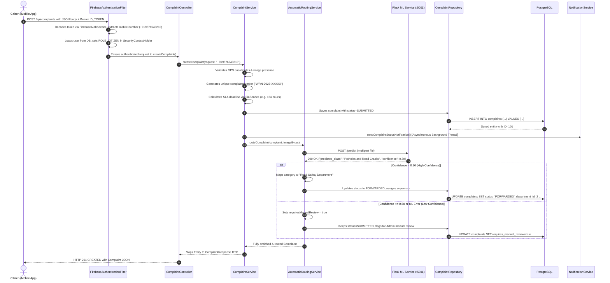

# 01. Backend Architecture (10 Minutes)

> **Urban Pulse: AI-Powered Smart Civic Intelligence Platform**  
> *Target Study Time: 10 Minutes*

---

## 1. What is the Backend of Urban Pulse?

The backend of **Urban Pulse** is the central nervous system of the civic grievance platform. While the React Native mobile app acts as the user interface on citizens' and municipal workers' smartphones, the backend is responsible for:

1. **Processing and Validating Civic Complaints:** Receiving complaints containing GPS coordinates, photos, and descriptions.
2. **AI/ML Automated Triage:** Sending uploaded civic images to a specialized Machine Learning inference service (`MobileNetV2` fine-tuned model) to classify issue types (e.g., Potholes, Garbage, Drainage) and calculating confidence scores.
3. **Smart Departmental Routing:** Automatically forwarding complaints with > 50% ML confidence to appropriate civic departments (Sanitation, Road Safety, Electrical, etc.) and assigning them to active supervisors, while flagging low-confidence complaints for Admin manual review.
4. **Duplicate Complaint Detection:** Using the **Haversine formula** to detect whether a nearby complaint has already been submitted within a 30-meter radius, allowing citizens to "Join" existing complaints instead of clogging municipal workflows.
5. **Role-Based Access Control (RBAC):** Enforcing strict operational boundaries between four distinct user roles: `CITIZEN`, `WORKER`, `SUPERVISOR`, and `ADMIN`.
6. **SLA (Service Level Agreement) Tracking:** Calculating resolution deadlines (e.g., 24 hours for potholes, 12 hours for garbage) and tracking municipal efficiency.
7. **Audit Logging & Push Notifications:** Maintaining immutable status history records and sending asynchronous push notifications via Firebase Cloud Messaging (FCM).

---

## 2. Why Did We Use Spring Boot?

Urban Pulse uses **Spring Boot 3.3.4** on **Java 17**. Here is why Spring Boot was selected over Node.js (Express), Python (Django), or standard Java EE:

| Reason | How It Directly Benefits Urban Pulse |
| :--- | :--- |
| **Enterprise Robustness & Type Safety** | Java 17 provides strong static typing, preventing runtime data errors when handling financial budgets, citizen credentials, and civic compliance records. |
| **Production-Ready Starter Architecture** | Out-of-the-box starters (`spring-boot-starter-web`, `spring-boot-starter-data-jpa`, `spring-boot-starter-security`) eliminate hundreds of lines of boilerplate XML configuration. |
| **Declarative Transactions (`@Transactional`)** | Complex multi-step operations (e.g., creating a complaint, saving audit history, and updating SLA) succeed or fail as a single atomic database transaction. |
| **Seamless Security Ecosystem** | Spring Security 6 provides a battle-tested filter chain architecture, making it simple to plug in custom Firebase Bearer Token filters and method-level security (`@PreAuthorize`). |
| **Embedded Server** | Ships with an embedded Tomcat server, allowing the backend to run as a standalone executable `.jar` without manual web-server deployment. |

---

## 3. How the Backend is Structured: Layered Architecture

Urban Pulse follows the industry-standard **N-Tier (Layered) Architecture**. Each layer has a single, strictly defined responsibility:

```
[ HTTP Requests from React Native ]
               │
               ▼
   ┌───────────────────────┐
   │   Controller Layer    │  <-- REST Endpoints, HTTP Statuses, DTO Validation
   └───────────┬───────────┘
               │
               ▼
   ┌───────────────────────┐
   │     Service Layer     │  <-- Business Logic, Haversine, ML Routing, SLAs
   └───────────┬───────────┘
               │
               ▼
   ┌───────────────────────┐
   │   Repository Layer    │  <-- Spring Data JPA Interfaces, SQL Queries
   └───────────┬───────────┘
               │
               ▼
   ┌───────────────────────┐
   │     Entity Layer      │  <-- Java Objects mapped to PostgreSQL Tables
   └───────────┬───────────┘
               │
               ▼
   [ PostgreSQL Database ]
```

### The 4 Core Layers Explained Simply

#### 1. Controllers (`com.urbanpulse.controller`)
* **Role:** The entry point for incoming HTTP requests.
* **Responsibilities:**
  - Map HTTP endpoints (`@GetMapping`, `@PostMapping`, `@PatchMapping`).
  - Validate request payloads (`@Valid @RequestBody`).
  - Read security context (`Authentication authentication`).
  - Return HTTP response codes (`200 OK`, `201 CREATED`, `400 BAD REQUEST`, `403 FORBIDDEN`).
  - **Rule:** Controllers never contain database queries or complex business logic.
* *Urban Pulse Examples:* `ComplaintController`, `AdminComplaintController`, `SupervisorComplaintController`, `WorkerComplaintController`, `AuthController`.

#### 2. Services (`com.urbanpulse.service`)
* **Role:** The brain of the application where all business rules live.
* **Responsibilities:**
  - Execute mathematical formulas (e.g., Haversine distance in `ComplaintService`).
  - Call external microservices via `RestTemplate` (e.g., `MlInferenceService` calling Python Flask).
  - Manage database transaction boundaries (`@Transactional`).
  - Enforce permission checks and business constraints.
* *Urban Pulse Examples:* `ComplaintService`, `AutomaticRoutingService`, `SlaService`, `MlInferenceService`, `FirebaseAuthService`, `NotificationService`.

#### 3. Repositories (`com.urbanpulse.repository`)
* **Role:** The data access layer.
* **Responsibilities:**
  - Extend Spring Data JPA's `JpaRepository<Entity, ID>`.
  - Provide ready-to-use CRUD operations (`save()`, `findById()`, `findAll()`, `delete()`).
  - Generate automatic SQL queries through method name conventions (e.g., `findByCitizenMobileNumberOrderByCreatedAtDesc()`).
* *Urban Pulse Examples:* `ComplaintRepository`, `UserRepository`, `DepartmentRepository`, `ComplaintParticipantRepository`, `ComplaintStatusHistoryRepository`.

#### 4. Entities (`com.urbanpulse.entity`)
* **Role:** Object-Relational Mapping (ORM) models.
* **Responsibilities:**
  - Represent actual tables in PostgreSQL using JPA annotations (`@Entity`, `@Table`, `@Column`, `@Id`, `@ManyToOne`).
* *Urban Pulse Examples:* `Complaint`, `User`, `Department`, `ComplaintParticipant`, `ComplaintStatusHistory`.

---

## 4. System Communications & External Integrations

### How the Frontend Communicates with the Backend
- **Protocol:** HTTP/1.1 REST APIs returning `application/json`.
- **Base URL:** Defined in React Native config (`src/config/api.ts`): `http://<LAN_IP>:8080`.
- **Security:** Every authenticated request sends an `Authorization: Bearer <FIREBASE_ID_TOKEN>` header.

### How Spring Boot Communicates with PostgreSQL
- Spring Boot uses the official **PostgreSQL JDBC Driver** (`org.postgresql:postgresql`) and **HikariCP** (high-performance connection pooling).
- **Hibernate ORM** automatically translates Java entity operations into raw SQL commands (`INSERT`, `SELECT`, `UPDATE`).
- In `application.properties`, `spring.jpa.hibernate.ddl-auto=update` ensures the schema automatically syncs with entity definitions.

### How the ML Model Connects to the Backend
- The ML classifier runs as an independent Python Flask microservice on port `5001`.
- When a complaint image is received, Spring Boot's `MlInferenceService` calls `http://localhost:5001/predict` using Spring's `RestTemplate` sending a `multipart/form-data` payload containing the image bytes.
- It receives a JSON response with `predicted_class` and `confidence` score.
- **Fault-Tolerant Isolation:** If the Python ML service is down, Spring Boot catches the exception gracefully, flags the complaint with `requiresManualReview = true`, and routes it to the Admin dashboard without failing the citizen's complaint submission!

### How External Services (Firebase) Fit In
- **Firebase Auth:** Handles SMS OTP verification on the React Native mobile app. Spring Boot uses `com.google.firebase:firebase-admin` to cryptographically verify the resulting asymmetric JWT token against Google's public keys.
- **Firebase Cloud Messaging (FCM):** When a complaint status changes (e.g., `SUBMITTED` $\rightarrow$ `ASSIGNED` $\rightarrow$ `RESOLVED`), `NotificationService` calls `FirebaseMessaging.getInstance().send(message)` asynchronously (`@Async`) to deliver push notifications to citizens' phones.

---

## 5. End-to-End System Architecture Diagram

```mermaid
flowchart TD
    subgraph Client["Frontend Client (React Native / Expo)"]
        RN["Mobile App UI"]
        FBA_CLIENT["Firebase Auth Client (SMS OTP)"]
    end

    subgraph SpringBoot["Urban Pulse Backend (Spring Boot 3.3.4 :8080)"]
        SEC_FILTER["FirebaseAuthenticationFilter\n(Bearer Token Validator)"]
        
        subgraph Controllers["REST Controllers"]
            CC["ComplaintController\n(/api/complaints)"]
            AC["AdminComplaintController\n(/api/admin/complaints)"]
            SC["SupervisorComplaintController\n(/api/supervisor/complaints)"]
            WC["WorkerComplaintController\n(/api/worker/complaints)"]
        end
        
        subgraph Services["Service Layer (Business Logic)"]
            CS["ComplaintService\n(Haversine Distance & CRUD)"]
            ARS["AutomaticRoutingService\n(50% Confidence Triage)"]
            MLIS["MlInferenceService\n(RestTemplate Client)"]
            SS["SlaService\n(Deadlines & Tracking)"]
            NS["NotificationService\n(@Async Push Sender)"]
        end

        subgraph Repos["Data Access Layer (Spring Data JPA)"]
            CR["ComplaintRepository"]
            UR["UserRepository"]
            DR["DepartmentRepository"]
            CPR["ComplaintParticipantRepository"]
            HR["ComplaintStatusHistoryRepository"]
        end
    end

    subgraph PythonML["ML Inference Service (Flask :5001)"]
        FLASK["Flask /predict Endpoint"]
        MODEL["MobileNetV2 Keras Model\n(8-Class Civic Classifier)"]
    end

    subgraph GoogleCloud["External Services (Firebase)"]
        FB_AUTH["Google Firebase Auth Server"]
        FB_FCM["Firebase Cloud Messaging (FCM)"]
    end

    subgraph Database["Relational Storage"]
        PG[("PostgreSQL Database\n(urbanpulse :5432)")]
    end

    %% Client authentication flow
    RN -->|"1. Phone Number"| FBA_CLIENT
    FBA_CLIENT -->|"2. Verify OTP"| FB_AUTH
    FB_AUTH -->>|"3. Returns ID Token (JWT)"| FBA_CLIENT
    
    %% API Flow
    RN -->|"4. REST Call + Bearer Token"| SEC_FILTER
    SEC_FILTER -->|"5. Validate Token Claims"| FB_AUTH
    SEC_FILTER -->|"6. Populate SecurityContext"| CC
    
    %% Controller to Service
    CC --> CS
    CS --> SS
    CS --> ARS
    ARS -->|"7. POST /predict (Multipart)"| MLIS
    MLIS -->|"8. HTTP REST"| FLASK
    FLASK --> MODEL
    
    %% Service to Database
    ARS --> CR
    CS --> CR
    CS --> CPR
    CS --> HR
    CR --> PG
    CPR --> PG
    HR --> PG
    UR --> PG
    DR --> PG

    %% Notifications
    CS -.->|"9. Async Push Event"| NS
    NS -.->|"10. Send FCM Message"| FB_FCM
    FB_FCM -.->|"11. Push Notification"| RN
```

---

## 6. Complete Request-Response Lifecycle: Real API Walkthrough

Let us trace a real call to `POST /api/complaints` (Citizen submitting a new complaint):



---

### Key Takeaways for Your Interview
1. **Separation of Concerns:** Controllers handle HTTP; Services execute business logic; Repositories talk to the database; Entities model the schema.
2. **Stateless Security:** Urban Pulse does not use HTTP sessions; every request carries a cryptographically verifiable Firebase JWT.
3. **Graceful Degradation:** The Spring Boot backend treats the Python ML service as an external helper—if ML goes down, complaint creation still succeeds safely.

