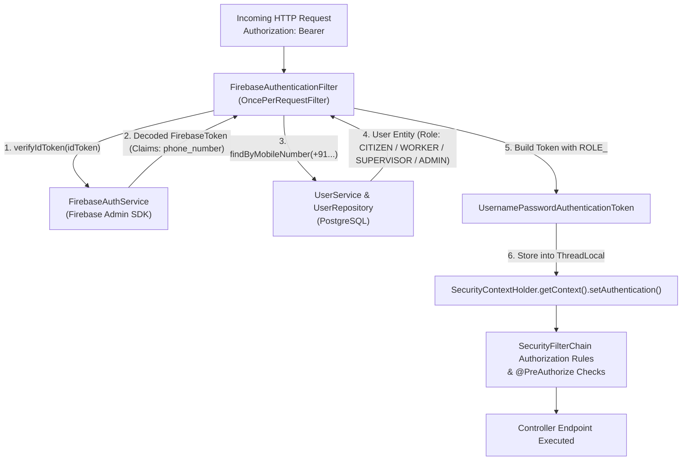
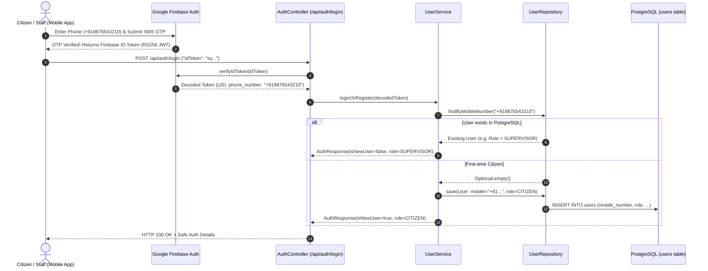
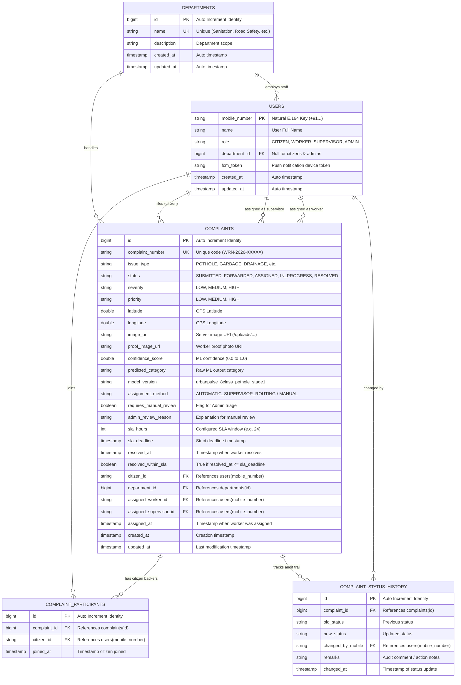

# 03. Authentication and Database Implementation (20 Minutes)

> **Urban Pulse: AI-Powered Smart Civic Intelligence Platform**  
> *Target Study Time: 20 Minutes (10 Mins Auth + 10 Mins DB)*

---

# PART 1: AUTHENTICATION & SPRING SECURITY

## 1. Passwordless OTP Architecture vs. Traditional BCrypt Passwords

In standard enterprise applications, users log in with an email and password hashed using BCrypt. However, **civic applications have unique real-world constraints**:
1. Most citizens will never remember a complex password when reporting a pothole on the road.
2. Fake accounts and bot submissions must be prevented by tying every complaint to a verified physical Indian mobile number (+91).
3. Mobile numbers are the universal citizen identifier across municipal governance portals.

Therefore, Urban Pulse uses **Passwordless Firebase Phone Number OTP Authentication** coupled with **Asymmetric RS256 JWTs**:
- The mobile app triggers Firebase Phone Auth; Google sends an SMS OTP.
- Upon OTP verification on the device, Firebase issues a cryptographically signed **Firebase ID Token (JWT)**.
- The client transmits this token to the Spring Boot backend via `Authorization: Bearer <ID_TOKEN>`.
- The backend cryptographically validates the token against Google's public certificates using the **Firebase Admin SDK**.

---

## 2. Core Spring Security Architecture in Urban Pulse



---

## 3. Key Security Classes and Their Responsibilities

### 1. `FirebaseConfig.java` (`com.urbanpulse.config`)
Initializes the Firebase Admin SDK on application startup using the service account credentials file:
```java
@Configuration
public class FirebaseConfig {
    @Value("${firebase.credentials.path:urbanpulse-firebase-admin.json}")
    private String credentialsPath;

    @PostConstruct
    public void initializeFirebase() throws IOException {
        if (FirebaseApp.getApps().isEmpty()) {
            GoogleCredentials credentials = GoogleCredentials.fromStream(new FileInputStream(credentialsPath));
            FirebaseOptions options = FirebaseOptions.builder()
                    .setCredentials(credentials)
                    .build();
            FirebaseApp.initializeApp(options);
        }
    }
}
```

### 2. `FirebaseAuthenticationFilter.java` (`com.urbanpulse.security`)
Extends `OncePerRequestFilter` to ensure it executes exactly once for every incoming request:
1. Reads the `Authorization` header and strips the `Bearer ` prefix.
2. Calls `firebaseAuthService.verifyIdToken(idToken)`.
3. Extracts the normalized phone number from the token's claims (`claims.get("phone_number")`).
4. Queries PostgreSQL via `userService.findByMobileNumber(normalizedPhone)`.
5. Maps the database role to a Spring GrantedAuthority: `ROLE_CITIZEN`, `ROLE_WORKER`, `ROLE_SUPERVISOR`, or `ROLE_ADMIN`.
6. Sets the authenticated principal into `SecurityContextHolder.getContext().setAuthentication(authentication)`.

### 3. `SecurityConfig.java` (`com.urbanpulse.config`)
Defines the `SecurityFilterChain` bean:
- **Stateless Sessions:** `SessionCreationPolicy.STATELESS` (no HTTP cookies or sessions stored on the server).
- **CSRF Disabled:** Because REST APIs using Bearer tokens are stateless and not susceptible to cookie-based CSRF attacks.
- **Filter Order:** Inserts `FirebaseAuthenticationFilter` ahead of `UsernamePasswordAuthenticationFilter`.
- **Role-Based Rules:**
  ```java
  .authorizeHttpRequests(auth -> auth
      .requestMatchers("/api/auth/**", "/uploads/**").permitAll()
      .requestMatchers("/api/admin/complaints/**").hasRole("ADMIN")
      .requestMatchers("/api/supervisor/complaints/**").hasRole("SUPERVISOR")
      .requestMatchers("/api/worker/complaints/**").hasRole("WORKER")
      .requestMatchers(HttpMethod.POST, "/api/users/staff").hasRole("ADMIN")
      .requestMatchers(HttpMethod.POST, "/api/users/workers").hasRole("SUPERVISOR")
      .anyRequest().authenticated()
  )
  ```

---

## 4. The Complete Login and Onboarding Flow



> **Staff Pre-Provisioning Note:** Workers and Supervisors cannot self-register. An Admin creates their phone numbers in PostgreSQL first (via `/api/users/staff`). When the worker subsequently logs in via OTP on their phone, the system recognizes their pre-assigned `WORKER` role immediately!

---

# PART 2: DATABASE AND JPA IMPLEMENTATION

## 1. Database Architecture & PostgreSQL Connection

Urban Pulse uses **PostgreSQL** as its enterprise relational database.
- **Connection Pool:** Uses **HikariCP** (Spring Boot's default high-performance connection pool), which keeps an active pool of database connections open to eliminate the latency of establishing new TCP sockets on every query.
- **DDL Synchronization:** `spring.jpa.hibernate.ddl-auto=update` automatically updates table columns and foreign keys when entity classes change without deleting existing rows.
- **Natural Primary Key:** The `users` table uses `mobile_number` (normalized E.164 string, e.g. `+919876543210`) as its Natural Primary Key (`@Id`), preventing duplicate citizen accounts.

---

## 2. Complete Entity-Relationship (ER) Diagram

The relationships among Users, Complaints, Departments, Workers, Supervisors, and Participants:



---

## 3. Database Constraints and Relational Integrity

Urban Pulse enforces strict data integrity both in Java code and at the PostgreSQL database level:

### 1. Unique Participation Constraint (`uk_complaint_citizen`)
In `ComplaintParticipant.java`:
```java
@Entity
@Table(
    name = "complaint_participants",
    uniqueConstraints = {
        @UniqueConstraint(
            name = "uk_complaint_citizen",
            columnNames = {"complaint_id", "citizen_id"}
        )
    }
)
public class ComplaintParticipant { ... }
```
**Why this matters:** Prevents race conditions where a citizen rapidly taps "Join" multiple times. Even if two concurrent HTTP requests pass the service layer check simultaneously, the PostgreSQL database engine throws a `DataIntegrityViolationException` on the second `INSERT`, protecting the participant count from tampering.

### 2. Unique Complaint Number
```java
@Column(name = "complaint_number", nullable = false, unique = true)
private String complaintNumber;
```
Ensures every civic issue gets an immutable tracking identifier (e.g., `WRN-2026-A8F2K`).

---

## 4. DTOs vs. Entities: Why the Separation is Essential

A common mistake in beginner projects is returning JPA Entities directly from Controllers. Urban Pulse strictly separates **Entities** from **Data Transfer Objects (DTOs)**:

| Aspect | Entity (`Complaint.java`) | DTO (`ComplaintResponse.java`) |
| :--- | :--- | :--- |
| **Location** | `com.urbanpulse.entity` | `com.urbanpulse.dto` |
| **Purpose** | Mirrors database schema; managed by Hibernate. | Defines the exact contract with the mobile frontend. |
| **Circular References** | Can cause infinite JSON recursion (e.g. User $\rightarrow$ Department $\rightarrow$ Users). | Flattened structure; zero circular references. |
| **Security** | Contains internal fields (`adminReviewReason`, internal IDs). | Hides sensitive data; exposes only safe public fields. |
| **Enriched Data** | Only stores database columns. | Can include computed fields like `joinCount`, `hasJoined`, `remainingMinutes`, `distanceMeters`. |

---

## 5. Spring Data JPA Repositories & SQL Translation

Here is how Spring Data JPA turns repository method signatures into real SQL queries:

### Example 1: Finding Citizen Complaints
* **Repository Method:**
  ```java
  List<Complaint> findByCitizenMobileNumberOrderByCreatedAtDesc(String citizenMobileNumber);
  ```
* **Hibernate Generated SQL:**
  ```sql
  SELECT c.* FROM complaints c
  WHERE c.citizen_id = '+919876543210'
  ORDER BY c.created_at DESC;
  ```

### Example 2: Checking Unique Participation
* **Repository Method:**
  ```java
  boolean existsByComplaintIdAndCitizenMobileNumber(Long complaintId, String citizenMobileNumber);
  ```
* **Hibernate Generated SQL:**
  ```sql
  SELECT EXISTS (
      SELECT 1 FROM complaint_participants cp
      WHERE cp.complaint_id = 101 AND cp.citizen_id = '+919876543210'
  );
  ```

### Example 3: Counting Joined Citizens
* **Repository Method:**
  ```java
  long countByComplaintId(Long complaintId);
  ```
* **Hibernate Generated SQL:**
  ```sql
  SELECT count(*) FROM complaint_participants cp
  WHERE cp.complaint_id = 101;
  ```

---

## 6. Database Transactions (`@Transactional`)

In `ComplaintService.java` and `UserService.java`, all write methods are annotated with `@Transactional`:
```java
@Transactional
public ComplaintResponse createComplaint(CreateComplaintRequest request, String citizenMobile) { ... }
```
- **Atomicity:** If an exception occurs after saving the complaint but before saving status history, Hibernate rolls back all changes. The database is never left in a corrupted or half-written state.
- **Dirty Checking:** Hibernate automatically detects any modifications made to entity objects during the transaction and writes them back to PostgreSQL upon method exit without requiring explicit calls to `save()`.
- **Read-Only Optimization:** Query-only methods use `@Transactional(readOnly = true)`, which tells PostgreSQL and Hibernate not to track dirty objects, drastically reducing memory overhead and CPU usage.

