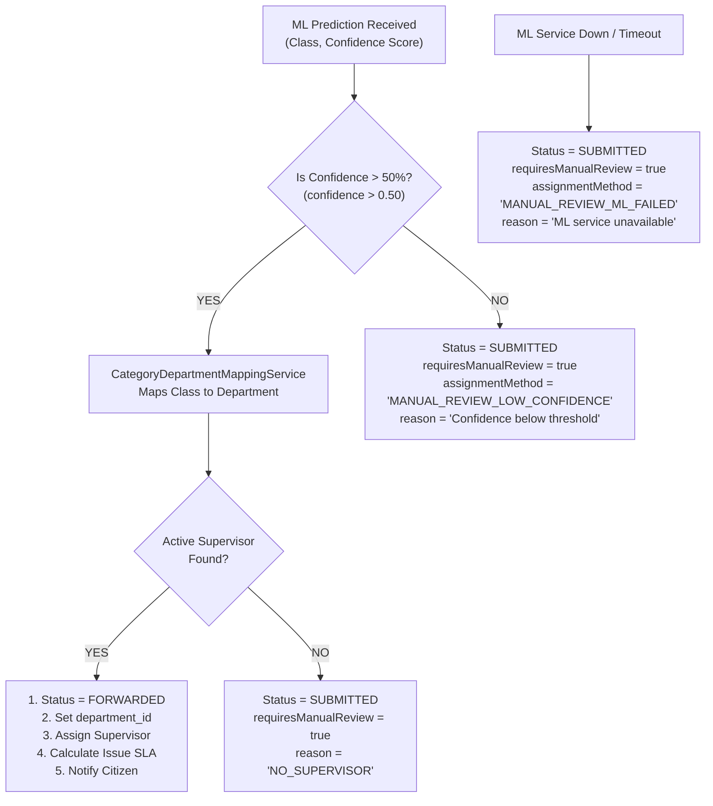

# 04. GPS, Image Processing, and ML Integration (20 Minutes)

> **Urban Pulse: AI-Powered Smart Civic Intelligence Platform**  
> *Target Study Time: 20 Minutes (10 Mins GPS/Images + 10 Mins ML)*

---

# PART 1: GPS AND IMAGE PROCESSING BACKEND WORKFLOW

## 1. GPS Coordinate Lifecycle in Spring Boot

Civic issues are inherently geographic. A complaint without an accurate physical location cannot be resolved by municipal ground teams.

```
[ Mobile GPS Sensor ]
        │ (latitude, longitude)
        ▼
[ React Native App (Expo Location) ]
        │ JSON Payload: { "latitude": 17.385044, "longitude": 78.486671, ... }
        ▼
[ Spring Boot Controller (ComplaintController.java) ]
        │ DTO Validation: @NotNull, coordinate boundaries [-90, 90], [-180, 180]
        ▼
[ Service Layer (ComplaintService.java) ]
        │ validateCoordinates()
        ▼
[ PostgreSQL Entity (Complaint.java) ]
        │ Double latitude, Double longitude
        ▼
[ PostgreSQL Table (complaints) ]
        │ NUMERIC / DOUBLE PRECISION
```

### 1. Frontend Capture and Transmission
The citizen's mobile app queries device hardware using GPS/GLONASS. It packages the raw coordinates into a JSON object and sends it via HTTP POST to `/api/complaints`:
```json
{
  "latitude": 17.385044,
  "longitude": 78.486671,
  "imageUrl": "/uploads/a3f12b77-84d2-4321-9988-123456789abc.jpg",
  "issueType": "POTHOLE",
  "severity": "HIGH"
}
```

### 2. Controller Reception & Validation
In `ComplaintController.java`:
```java
@PostMapping
@PreAuthorize("hasRole('CITIZEN')")
public ResponseEntity<ComplaintResponse> createComplaint(
        @Valid @RequestBody CreateComplaintRequest request,
        Authentication authentication) {
    String citizenMobile = authentication.getName();
    ComplaintResponse response = complaintService.createComplaint(request, citizenMobile);
    return ResponseEntity.status(HttpStatus.CREATED).body(response);
}
```

### 3. Service Processing and Coordinate Sanitation
In `ComplaintService.java`, coordinates are rigorously validated before touching the database:
```java
private void validateCoordinates(Double latitude, Double longitude) {
    if (latitude == null || longitude == null) {
        throw new IllegalArgumentException("Latitude and longitude coordinates are required.");
    }
    if (latitude < -90.0 || latitude > 90.0) {
        throw new IllegalArgumentException("Latitude must be between -90.0 and 90.0 degrees.");
    }
    if (longitude < -180.0 || longitude > 180.0) {
        throw new IllegalArgumentException("Longitude must be between -180.0 and 180.0 degrees.");
    }
}
```

### 4. Storage in PostgreSQL
Stored as high-precision 64-bit IEEE 754 floating-point values (`Double` in Java, `DOUBLE PRECISION` in PostgreSQL):
```java
@Column(name = "latitude", nullable = false)
private Double latitude;

@Column(name = "longitude", nullable = false)
private Double longitude;
```

### 5. Serving Location to Municipal Workers
When a worker opens their assigned complaint on their mobile app, the backend returns:
```json
{
  "complaintNumber": "WRN-2026-B91K2",
  "latitude": 17.385044,
  "longitude": 78.486671
}
```
The mobile app uses these coordinates to render a clickable Google Maps navigation intent:
```typescript
const googleMapsUrl = `https://www.google.com/maps/dir/?api=1&destination=${complaint.latitude},${complaint.longitude}`;
```

---

## 2. Image Upload Workflow & File Management

### 1. Endpoint and Multipart Handling
When a citizen snaps a photo, the mobile app first uploads the binary image file via multipart form-data to `POST /api/complaints/upload-image`:

```java
// com/urbanpulse/controller/ComplaintController.java
@PostMapping("/upload-image")
@PreAuthorize("isAuthenticated()")
public ResponseEntity<Map<String, String>> uploadImage(@RequestParam("file") MultipartFile file) {
    String imageUrl = complaintService.uploadImage(file);
    return ResponseEntity.ok(Map.of("imageUrl", imageUrl));
}
```

### 2. Disk Storage Mechanism (`FileStorageService.java`)
Rather than storing heavy binary BLOBs inside PostgreSQL (which destroys database performance and balloons backup sizes), Urban Pulse saves images to the physical file system:

```java
// com/urbanpulse/service/FileStorageService.java
@Service
public class FileStorageService {
    private final Path uploadDir = Paths.get("uploads").toAbsolutePath().normalize();

    public String storeFile(MultipartFile file) {
        if (file == null || file.isEmpty()) {
            throw new IllegalArgumentException("Cannot store empty file.");
        }

        // Extract original extension (.jpg, .png)
        String originalFilename = file.getOriginalFilename();
        String extension = (originalFilename != null && originalFilename.contains("."))
                ? originalFilename.substring(originalFilename.lastIndexOf(".")) : ".jpg";

        // Generate cryptographically unique UUID to avoid filename collisions
        String newFilename = UUID.randomUUID().toString() + extension;

        try {
            Path targetLocation = this.uploadDir.resolve(newFilename);
            Files.copy(file.getInputStream(), targetLocation, StandardCopyOption.REPLACE_EXISTING);
            return "/uploads/" + newFilename; // Store relative URI in DB
        } catch (IOException ex) {
            throw new RuntimeException("Could not store file. Please try again!", ex);
        }
    }
}
```

### 3. Exposing Images via Spring WebMVC
To make `/uploads/uuid.jpg` publicly accessible to the mobile app and ML service, `WebMvcConfig.java` registers a static resource handler:
```java
// com/urbanpulse/config/WebMvcConfig.java
@Configuration
public class WebMvcConfig implements WebMvcConfigurer {
    @Override
    public void addResourceHandlers(ResourceHandlerRegistry registry) {
        Path uploadDir = Paths.get("uploads").toAbsolutePath().normalize();
        registry.addResourceHandler("/uploads/**")
                .addResourceLocations(uploadDir.toUri().toString());
    }
}
```

---

# PART 2: MACHINE LEARNING BACKEND INTEGRATION

## 1. Machine Learning Architecture & Technology Stack

Urban Pulse integrates Artificial Intelligence to eliminate human triage delays. 

```
┌─────────────────────────────────┐
│     Spring Boot 3.3.4           │
│     (Port :8080)                │
│                                 │
│  - Complaint Creation           │
│  - RestTemplate HTTP Client     │
│  - Category Department Mapping  │
│  - Automated Routing Logic      │
└───────────────┬─────────────────┘
                │
                │ HTTP POST /predict
                │ (multipart/form-data: "file")
                ▼
┌─────────────────────────────────┐
│     Python Flask Microservice   │
│     (Port :5001)                │
│                                 │
│  - Flask Web API                │
│  - TensorFlow 2.x / Keras 3     │
│  - MobileNetV2 Architecture     │
│  - 8-Class Civic Issue Model    │
└─────────────────────────────────┘
```

### The ML Model Details
* **Base Architecture:** **MobileNetV2** (lightweight Convolutional Neural Network optimized for high inference speed and low latency).
* **Fine-Tuned Weights:** `urbanpulse_8class_pothole_stage1.keras`
* **Input Dimensions:** 224 $\times$ 224 pixels, RGB 3-channel (`float32`).
* **Supported 8 Civic Classes:**
  1. `Damaged Concrete Structures`
  2. `Damaged Electrical Poles`
  3. `Damaged Road Signs`
  4. `Dead Animals Pollution`
  5. `Fallen Trees`
  6. `Garbage`
  7. `Illegal Parking`
  8. `Potholes and Road Cracks`

---

## 2. Microservice Communication via `RestTemplate`

Spring Boot communicates with the Python Flask service via synchronous REST calls in `MlInferenceService.java`:

```java
// com/urbanpulse/service/MlInferenceService.java
@Service
public class MlInferenceService {
    private final String mlServiceUrl;
    private final RestTemplate restTemplate;

    public MlInferenceService(
            @Value("${urbanpulse.ml.service-url:http://localhost:5001}") String mlServiceUrl,
            @Value("${urbanpulse.ml.timeout-ms:8000}") int timeoutMs) {
        this.mlServiceUrl = mlServiceUrl;
        
        // Strict connection and read timeouts prevent thread blocking
        SimpleClientHttpRequestFactory factory = new SimpleClientHttpRequestFactory();
        factory.setConnectTimeout(Duration.ofMillis(timeoutMs));
        factory.setReadTimeout(Duration.ofMillis(timeoutMs));
        this.restTemplate = new RestTemplate(factory);
    }

    public Optional<MlPredictionResponse> predictImage(byte[] imageBytes, String filename) {
        String predictUrl = mlServiceUrl + "/predict";
        
        HttpHeaders headers = new HttpHeaders();
        headers.setContentType(MediaType.MULTIPART_FORM_DATA);

        ByteArrayResource fileResource = new ByteArrayResource(imageBytes) {
            @Override public String getFilename() { return filename; }
        };

        MultiValueMap<String, Object> body = new LinkedMultiValueMap<>();
        body.add("file", fileResource);

        HttpEntity<MultiValueMap<String, Object>> requestEntity = new HttpEntity<>(body, headers);

        try {
            ResponseEntity<MlPredictionResponse> response = restTemplate.postForEntity(
                    predictUrl, requestEntity, MlPredictionResponse.class
            );
            if (response.getStatusCode().is2xxSuccessful() && response.getBody() != null) {
                return Optional.of(response.getBody());
            }
        } catch (Exception ex) {
            logger.error("ML service unreachable: {}", ex.getMessage());
        }
        return Optional.empty(); // Safe fallback
    }
}
```

---

## 3. The 50% Confidence Routing Rule

In `AutomaticRoutingService.java`, Urban Pulse implements an **automated confidence-based decision engine**:



### Department Mapping Table (`CategoryDepartmentMappingService.java`)

| ML Predicted Class | Target Municipal Department | Default SLA Window |
| :--- | :--- | :--- |
| **Potholes and Road Cracks** | Road Safety Department | 24 Hours |
| **Garbage** | Sanitation Department | 12 Hours |
| **Damaged Electrical Poles** | Electrical Department | 24 Hours |
| **Dead Animals Pollution** | Public Health Department | 12 Hours |
| **Damaged Concrete Structures**| Engineering Department | 48 Hours |
| **Fallen Trees** | Horticulture Department | 24 Hours |
| **Illegal Parking** | Traffic Department | 6 Hours |

---

## 4. Fault Isolation: Why Complaints NEVER Fail if ML Crashes

In real-world civic systems, citizens must never receive an error page simply because an AI container crashed or ran out of GPU memory.

In `ComplaintService.java`:
```java
// 1. Complaint is already created and saved in PostgreSQL with status SUBMITTED
Complaint savedComplaint = complaintRepository.save(complaint);

// 2. Automated routing executes inside an isolated try-catch block:
try {
    byte[] imageBytes = fileStorageService.loadFileBytes(request.getImageUrl());
    Complaint routedComplaint = automaticRoutingService.routeComplaint(savedComplaint, imageBytes, request.getImageUrl());
    if (routedComplaint != null) {
        savedComplaint = routedComplaint;
    }
} catch (Exception ex) {
    logger.error("Automated routing failed: {}", ex.getMessage());
    savedComplaint.setAssignmentMethod("MANUAL_REVIEW_ROUTING_EXCEPTION");
    savedComplaint.setRequiresManualReview(true);
    savedComplaint.setAdminReviewReason("Automated routing encountered an issue: " + ex.getMessage());
    savedComplaint = complaintRepository.save(savedComplaint);
}

// 3. Always returns HTTP 201 Created to citizen!
return mapToResponse(savedComplaint, normalizedMobile);
```

### Interview Explanation:
> *"Our ML integration employs **Graceful Degradation**. The Python model acts as an advisory accelerator, not a single point of failure. If the ML inference service fails, times out, or returns a confidence score $\le 50\%$, the backend flags `requiresManualReview = true` and routes the complaint to the human Admin dashboard. The citizen's complaint submission is always guaranteed to succeed with HTTP 201."*

