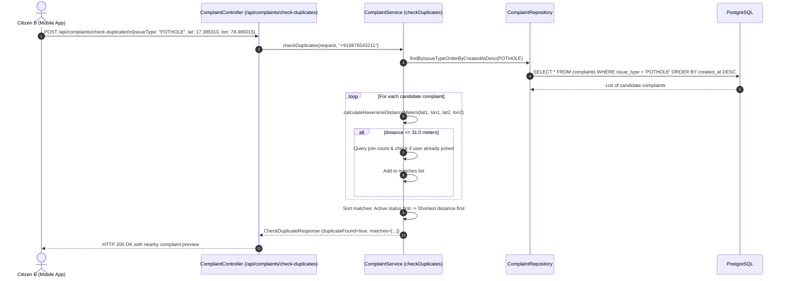

# 05. Duplicate Detection and Join Complaint (15 Minutes)

> **Urban Pulse: AI-Powered Smart Civic Intelligence Platform**  
> *Target Study Time: 15 Minutes*

---

## 1. Why Duplicate Detection is Critical in Civic Platforms

In municipal governance, **duplicate reporting is the number one operational bottleneck**:
- When a large pothole appears on a busy arterial road, 20 different citizens might photograph and report it within two hours.
- Without duplicate detection, the municipal platform creates 20 independent work orders, dispatches multiple repair vans to the exact same spot, and wastes municipal tax funds.
- Closing 19 complaints as "rejected duplicates" alienates citizens who feel ignored.

**The Urban Pulse Solution: "Join Complaint" Mobilization**
Instead of blocking citizens or creating redundant work orders, Urban Pulse detects nearby active complaints of the same category and lets citizens **"Join"** the complaint.
- The complaint's priority rises with every new citizen backer.
- All joined citizens receive automated push notifications as the issue progresses to `RESOLVED`.
- Municipal workers handle one single, consolidated work order.

---

## 2. Mathematical Foundation: The Haversine Formula

The Earth is not flat; it is an oblate spheroid. Calculating the distance between two GPS coordinates using simple Euclidean distance ($\sqrt{\Delta x^2 + \Delta y^2}$) produces massive errors because lines of longitude converge at the poles.

The **Haversine Formula** calculates the great-circle distance between two points on a sphere given their longitudes and latitudes.

### The Mathematical Formula

$$\Delta \phi = \text{lat}_2 - \text{lat}_1$$
$$\Delta \lambda = \text{lon}_2 - \text{lon}_1$$

$$a = \sin^2\left(\frac{\Delta \phi}{2}\right) + \cos(\phi_1) \cdot \cos(\phi_2) \cdot \sin^2\left(\frac{\Delta \lambda}{2}\right)$$

$$c = 2 \cdot \text{atan2}\left(\sqrt{a}, \sqrt{1 - a}\right)$$

$$d = R \cdot c$$

Where:
- $\phi_1, \phi_2$ = latitudes in radians
- $\Delta \phi$ = latitude difference in radians
- $\Delta \lambda$ = longitude difference in radians
- $R$ = Earth's mean spherical radius ($6,371,000\text{ meters}$)
- $d$ = distance between the two points in meters

---

## 3. Actual Code Implementation in Spring Boot

In `ComplaintService.java`, the formula is implemented as a high-performance static method:

```java
// com/urbanpulse/service/ComplaintService.java
public static double calculateHaversineDistanceMeters(double lat1, double lon1, double lat2, double lon2) {
    final double R = 6371000.0; // Earth's mean radius in meters
    double phi1 = Math.toRadians(lat1);
    double phi2 = Math.toRadians(lat2);
    double deltaPhi = Math.toRadians(lat2 - lat1);
    double deltaLambda = Math.toRadians(lon2 - lon1);

    double a = Math.sin(deltaPhi / 2.0) * Math.sin(deltaPhi / 2.0)
            + Math.cos(phi1) * Math.cos(phi2)
            * Math.sin(deltaLambda / 2.0) * Math.sin(deltaLambda / 2.0);
    double c = 2.0 * Math.atan2(Math.sqrt(a), Math.sqrt(1.0 - a));

    double distance = R * c;
    return Math.round(distance * 10.0) / 10.0; // Rounded to 1 decimal place
}
```

---

## 4. The 30-Meter Radius & GPS Jitter Tolerance

In urban environments, tall buildings and atmospheric interference cause smartphone GPS hardware to "jitter" (fluctuate by 1–2 meters).

Urban Pulse defines:
```java
public static final double DEFAULT_DUPLICATE_RADIUS_METERS = 30.0;
public static final double GPS_TOLERANCE_METERS = 1.0;
```
The effective search radius is:
$$\text{effectiveMaxDistance} = \text{radius} + \text{GPS\_TOLERANCE\_METERS} = 30.0 + 1.0 = 31.0\text{ meters}$$

This ensures that a citizen standing on the opposite sidewalk 30.5 meters away is not excluded due to sensor noise.

---

## 5. Duplicate Checking Execution Flow



### Candidate Filtering and Sorting Strategy
In `ComplaintService.java`:
1. **Candidate Retrieval:** Queries database by `issue_type` (`POTHOLE`, `GARBAGE`, etc.).
2. **Haversine Distance Filter:** Computes distance to every candidate in memory. Candidates within $\le 31.0\text{m}$ are selected.
3. **Multi-Tier Sorting:**
   - **Tier 1:** Active complaints (`SUBMITTED`, `FORWARDED`, `ASSIGNED`, `IN_PROGRESS`) appear before resolved complaints.
   - **Tier 2:** Shortest distance first (nearest complaint at 5 meters takes precedence over one at 28 meters).
   - **Tier 3:** Newest created complaint first.

---

## 6. Joining an Existing Complaint: Implementation & Integrity

When the mobile app displays an existing complaint nearby, the citizen can tap **"Join Complaint"**, which invokes `POST /api/complaints/{id}/join`.

### Preventing Duplicate Participation at 2 Levels

```
Level 1: Java Service Layer Check (Fast Memory Lookup)
   └── complaintParticipantRepository.findByComplaintIdAndCitizenMobileNumber(...)
       └── Returns alreadyJoined=true if already present.

Level 2: PostgreSQL Database Unique Constraint (Absolute Concurrency Lock)
   └── @UniqueConstraint(name = "uk_complaint_citizen", columnNames = {"complaint_id", "citizen_id"})
       └── Throws DataIntegrityViolationException on race conditions.
```

### The Service Method: `joinComplaint()`
```java
// com/urbanpulse/service/ComplaintService.java
@Transactional
public JoinComplaintResponse joinComplaint(Long complaintId, String citizenMobile) {
    String normalizedMobile = PhoneNumberUtil.normalize(citizenMobile);
    User citizen = userRepository.findByMobileNumber(normalizedMobile)
            .orElseThrow(() -> new IllegalArgumentException("Citizen not found: " + normalizedMobile));

    if (citizen.getRole() != Role.CITIZEN) {
        throw new AccessDeniedException("Only CITIZEN can join existing complaints.");
    }

    Complaint complaint = complaintRepository.findById(complaintId)
            .orElseThrow(() -> new IllegalArgumentException("Complaint not found with ID: " + complaintId));

    // Only active complaints can be joined
    if (complaint.getStatus() != null && !ACTIVE_STATUSES.contains(complaint.getStatus())) {
        throw new IllegalStateException("Only active complaints can be joined.");
    }

    // 1. Check if citizen is the original author
    if (complaint.getCitizen() != null && complaint.getCitizen().getMobileNumber().equals(normalizedMobile)) {
        return JoinComplaintResponse.builder()
                .alreadyJoined(true)
                .isOriginalReporter(true)
                .message("You are the original reporter of this complaint.")
                .build();
    }

    // 2. Check if already joined
    Optional<ComplaintParticipant> existingOpt = complaintParticipantRepository
            .findByComplaintIdAndCitizenMobileNumber(complaintId, normalizedMobile);
    if (existingOpt.isPresent()) {
        return JoinComplaintResponse.builder()
                .alreadyJoined(true)
                .isOriginalReporter(false)
                .message("You have already joined this complaint.")
                .build();
    }

    // 3. Persist new participant
    ComplaintParticipant participant = ComplaintParticipant.builder()
            .complaint(complaint)
            .citizen(citizen)
            .build();
    complaintParticipantRepository.save(participant);

    long newJoinCount = complaintParticipantRepository.countByComplaintId(complaintId);
    return JoinComplaintResponse.builder()
            .complaintId(complaintId)
            .joinCount(newJoinCount)
            .message("Successfully joined complaint.")
            .build();
}
```

---

## 7. Practical End-to-End Walkthrough Example

### Scenario Setup
* Pothole at MG Road: Latitude `17.385000`, Longitude `78.486000`.

---

### Step 1: Citizen A Reports the Pothole
- **Action:** Submits `POST /api/complaints`.
- **Database Action:**
  - `complaints` table inserts Row #101:
    ```sql
    INSERT INTO complaints (complaint_number, issue_type, latitude, longitude, citizen_id, status)
    VALUES ('WRN-2026-001', 'POTHOLE', 17.385000, 78.486000, '+919876543210', 'SUBMITTED');
    ```
- **Result:** Work order created. Initial Join Count = `0`.

---

### Step 2: Citizen B Reports 15 Meters Away
- **Action:** Citizen B stands at `17.385100, 78.486080` (calculated distance = **13.8 meters**).
- **Backend Flow:**
  1. Frontend calls `POST /api/complaints/check-duplicates`.
  2. Haversine distance is calculated:
     $$\text{distance} = 13.8\text{ meters} \le 31.0\text{ meters (Match Found!)}$$
  3. Backend returns `duplicateFound: true` with Complaint #101 summary.
  4. Frontend displays: *"A pothole was already reported 14 meters away. Join this complaint to boost its priority!"*
  5. Citizen B clicks **"Join Complaint"** (`POST /api/complaints/101/join`).
- **Database Action:**
  ```sql
  INSERT INTO complaint_participants (complaint_id, citizen_id, joined_at)
  VALUES (101, '+919876543211', NOW());
  ```
- **Result:** No duplicate work order created. Complaint #101 Join Count becomes `1`. Both Citizen A and Citizen B will receive status updates!

---

### Step 3: Citizen C Reports 50 Meters Away
- **Action:** Citizen C stands at `17.385450, 78.486000` (calculated distance = **50.1 meters**).
- **Backend Flow:**
  1. Frontend calls `POST /api/complaints/check-duplicates`.
  2. Haversine distance is calculated:
     $$\text{distance} = 50.1\text{ meters} > 31.0\text{ meters (No Match)}$$
  3. Backend returns `duplicateFound: false`, `matches: []`.
  4. Frontend proceeds to submit a new complaint.
- **Database Action:**
  - `complaints` table inserts Row #102 as an independent complaint.
- **Result:** A new complaint is created because 50 meters on an urban street indicates a distinct, separate pothole.

