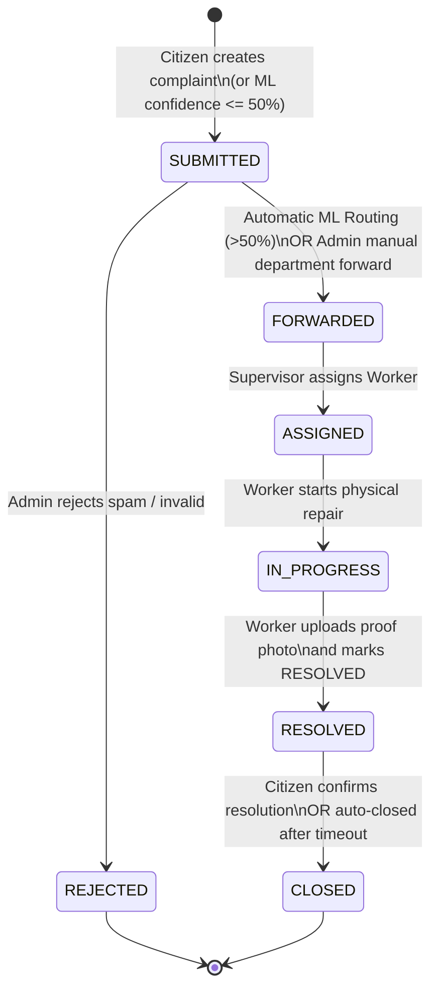
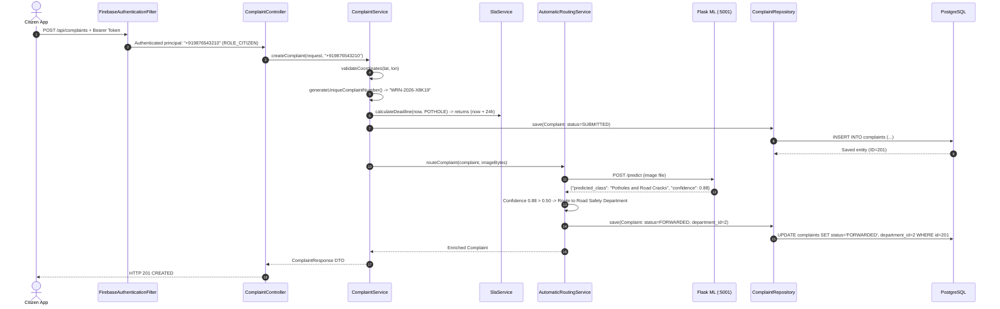
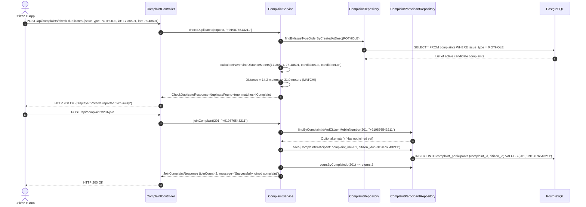

# 06. Complaint Management and Request Flows (15 Minutes)

> **Urban Pulse: AI-Powered Smart Civic Intelligence Platform**  
> *Target Study Time: 15 Minutes (10 Mins Lifecycle + 5 Mins Request Flows)*

---

# PART 1: COMPLAINT LIFECYCLE & ROLE OPERATIONS

## 1. Complaint State Machine

Every complaint in Urban Pulse moves through a strictly governed state machine defined by the `ComplaintStatus` enum:



### The 7 Implemented Statuses Explained

| Status | Meaning | Permitted Role to Set |
| :--- | :--- | :--- |
| **`SUBMITTED`** | Initial intake state. Stored with GPS and photo. Awaiting triage. | `CITIZEN` (upon creation) |
| **`FORWARDED`** | Mapped to a specific municipal department (e.g., Road Safety). | `SYSTEM` (Automatic ML) or `ADMIN` |
| **`ASSIGNED`** | Allocated to a field worker for physical inspection and repair. | `SUPERVISOR` or `ADMIN` |
| **`IN_PROGRESS`** | Worker has arrived on-site and commenced repair work. | `WORKER` |
| **`RESOLVED`** | Repair is complete; mandatory proof image uploaded. | `WORKER` |
| **`CLOSED`** | Final state after citizen verification or automated completion. | `CITIZEN` or `ADMIN` |
| **`REJECTED`** | Spam, abusive content, or out-of-jurisdiction issue. | `ADMIN` |

---

## 2. SLA (Service Level Agreement) Management & Non-Resetting Deadlines

In `SlaService.java`, civic issues have legally binding resolution timeframes:
- **`WATER_LEAK`**: 6 Hours (Critical water loss)
- **`GARBAGE`**: 12 Hours (Public health hazard)
- **`DRAINAGE_ISSUE`**: 12 Hours (Vector disease risk)
- **`POTHOLE`**: 24 Hours (Road safety)
- **`STREET_LIGHT_DAMAGE`**: 24 Hours (Night crime prevention)
- **`INFRASTRUCTURE_DAMAGE`**: 48 Hours (Structural repairs)

```java
// com/urbanpulse/service/SlaService.java
public LocalDateTime calculateDeadline(LocalDateTime createdAt, IssueType issueType) {
    if (createdAt == null) {
        createdAt = LocalDateTime.now();
    }
    int hours = getSlaHours(issueType);
    return createdAt.plusHours(hours);
}
```

### Critical Architectural Rule: SLA Deadlines NEVER Reset!
A common municipal failure is resetting the countdown timer every time an issue is bounced between departments.
In Urban Pulse's `ComplaintService.forwardComplaint()`:
```java
// SLA MUST NOT RESET: original slaHours and slaDeadline remain intact
complaint.setDepartment(department);
complaint.setStatus(ComplaintStatus.FORWARDED);
complaintRepository.save(complaint);
```
When a worker marks a complaint as `RESOLVED`, the system permanently records whether the deadline was met:
```java
LocalDateTime now = LocalDateTime.now();
complaint.setResolvedAt(now);
complaint.setResolvedWithinSla(complaint.getSlaDeadline() != null && !now.isAfter(complaint.getSlaDeadline()));
```

---

## 3. Operations by User Role

### 1. Citizen Operations (`ComplaintController.java`)
- `POST /api/complaints` - Create a complaint with photo and GPS.
- `GET /api/complaints/my` - Fetch all complaints filed by the authenticated citizen.
- `GET /api/complaints/joined` - Fetch complaints the citizen has joined as a backer.
- `POST /api/complaints/check-duplicates` - Scan for nearby active complaints.
- `POST /api/complaints/{id}/join` - Join an existing active complaint.

### 2. Worker Operations (`WorkerComplaintController.java`)
- `GET /api/worker/complaints` - Fetch complaints assigned specifically to this worker.
- `POST /api/worker/complaints/{id}/proof` - Upload completion photo (stored in `proof_image_url`).
- `PATCH /api/worker/complaints/{id}/status` - Move status to `IN_PROGRESS` or `RESOLVED`.
- **Validation:** Workers cannot update complaints assigned to other workers!

### 3. Supervisor Operations (`SupervisorComplaintController.java`)
- `GET /api/supervisor/complaints` - View all complaints forwarded to their department.
- `PATCH /api/supervisor/complaints/{id}/assign` - Assign a department worker to the complaint.
- `POST /api/users/workers` - Create worker accounts scoped to their department.

### 4. Admin Operations (`AdminComplaintController.java`)
- `GET /api/admin/complaints` - Global view of all city complaints.
- `PATCH /api/admin/complaints/{id}/forward` - Manually override department assignment.
- `PATCH /api/admin/complaints/{id}/manual-assign` - Manually assign supervisor and worker for low-confidence ML complaints.
- `POST /api/users/staff` - Create new Supervisor and Worker accounts for any department.

---

# PART 2: THREE COMPLETE BACKEND REQUEST FLOWS

---

## Flow 1: Citizen Submits a New Complaint



---

## Flow 2: Backend Detects a Duplicate Complaint & Citizen Joins



---

## Flow 3: Worker Updates Status to RESOLVED with Proof Image

```mermaid
sequenceDiagram
    autonumber
    actor Worker as Field Worker
    participant Filter as FirebaseAuthenticationFilter
    participant Ctrl as WorkerComplaintController
    participant CS as ComplaintService
    participant FS as FileStorageService
    participant Repo as ComplaintRepository
    participant HistRepo as ComplaintStatusHistoryRepository
    participant FCM as NotificationService
    participant DB as PostgreSQL

    %% Step 1: Upload Proof Photo
    Worker->>Ctrl: POST /api/worker/complaints/201/proof (file: completion_photo.jpg)
    Ctrl->>CS: uploadProofImage(201, file, "+919876543299")
    CS->>CS: Verify worker is assigned to complaint #201
    CS->>FS: storeFile(file) -> returns "/uploads/proof-uuid.jpg"
    CS->>Repo: save(Complaint: proof_image_url="/uploads/proof-uuid.jpg")
    Repo->>DB: UPDATE complaints SET proof_image_url='/uploads/proof-uuid.jpg' WHERE id=201
    CS-->>Ctrl-->>Worker: HTTP 200 OK (Proof image saved)

    %% Step 2: Mark Resolved
    Worker->>Ctrl: PATCH /api/worker/complaints/201/status {status: "RESOLVED", remarks: "Repaired"}
    Ctrl->>CS: updateWorkerStatus(201, request, "+919876543299")
    CS->>CS: Validate: proofImageUrl must NOT be null when status=RESOLVED!
    
    CS->>CS: Record resolvedAt = NOW()
    CS->>CS: resolvedWithinSla = !NOW().isAfter(slaDeadline)
    
    CS->>Repo: save(Complaint: status=RESOLVED, resolved_at=NOW(), resolved_within_sla=true)
    Repo->>DB: UPDATE complaints SET status='RESOLVED', resolved_at=NOW(), resolved_within_sla=true WHERE id=201
    
    CS->>HistRepo: save(ComplaintStatusHistory: old=IN_PROGRESS, new=RESOLVED, changedBy=worker)
    HistRepo->>DB: INSERT INTO complaint_status_history (...)
    
    CS->>FCM: sendComplaintStatusNotification(citizen.fcmToken, "RESOLVED") [Async Push Alert]
    CS-->>Ctrl: ComplaintResponse DTO
    Ctrl-->>Worker: HTTP 200 OK
```

---

### Key Takeaways for Your Interview
1. **Mandatory Proof Enforcement:** The backend enforces business rules at the code level—a worker cannot mark a complaint as `RESOLVED` unless `proofImageUrl` is already present.
2. **Audit History Immutability:** Every single state transition is recorded in `complaint_status_history` with the exact actor's mobile number, timestamp, and remarks.
3. **SLA Accountability:** When resolving, `resolvedWithinSla` is automatically computed by comparing `resolvedAt` against `slaDeadline`.

